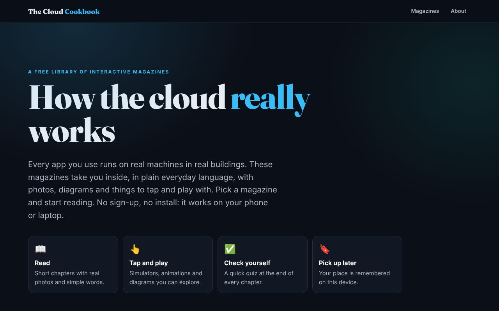
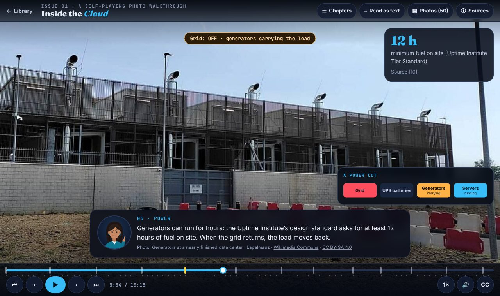
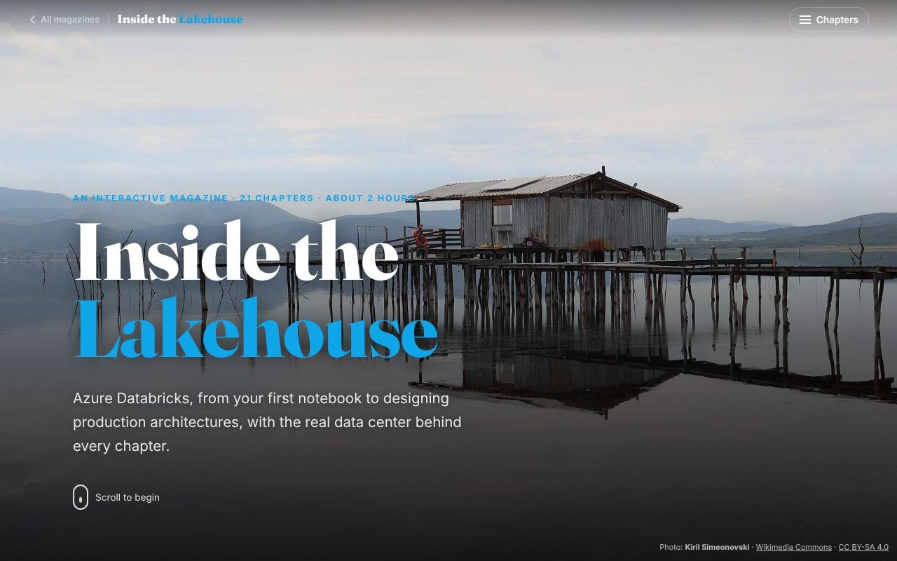
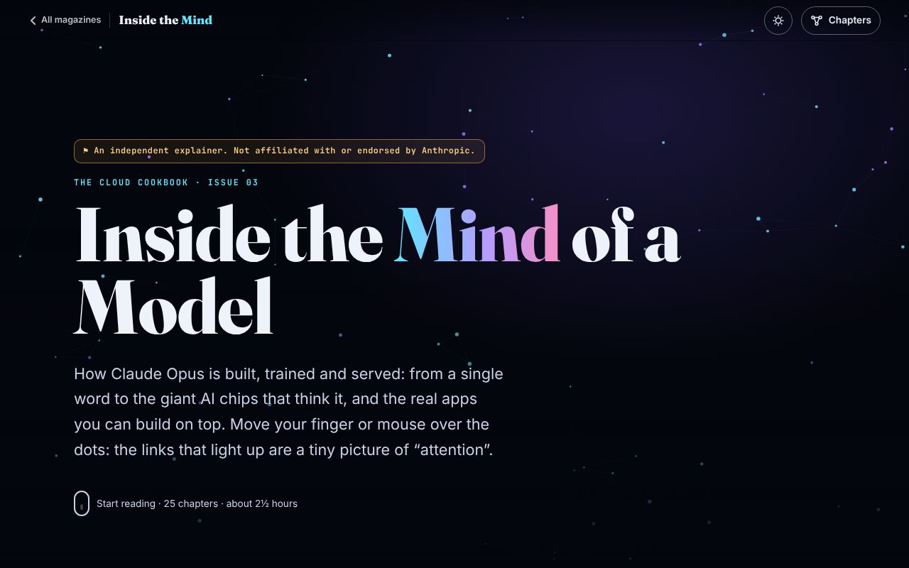
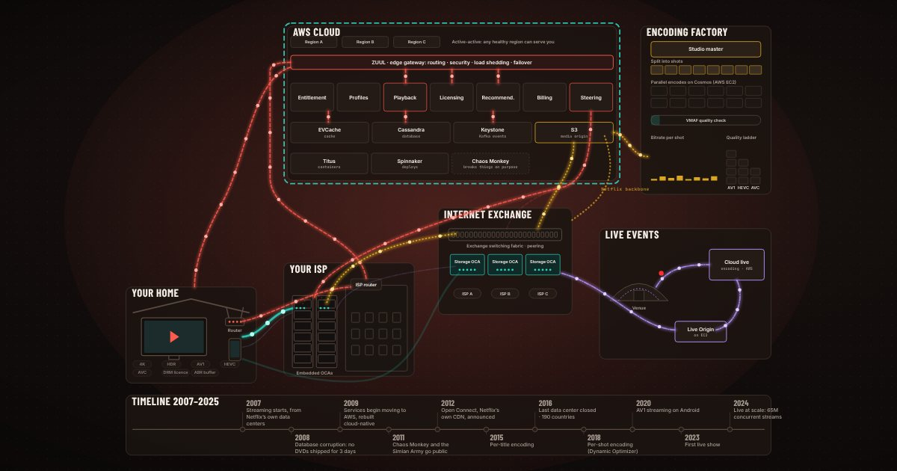
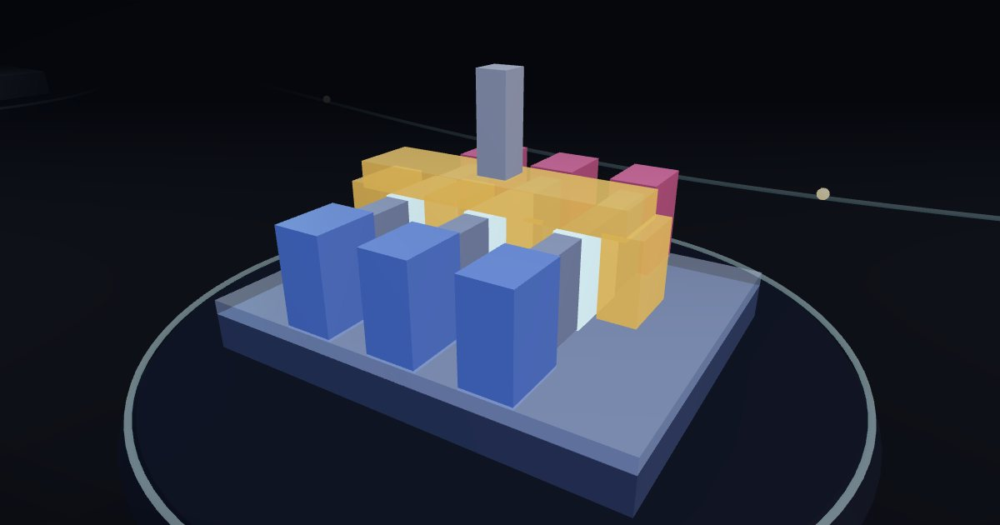
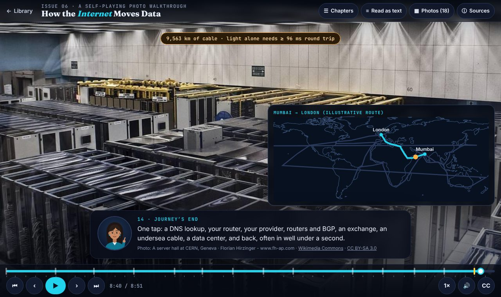
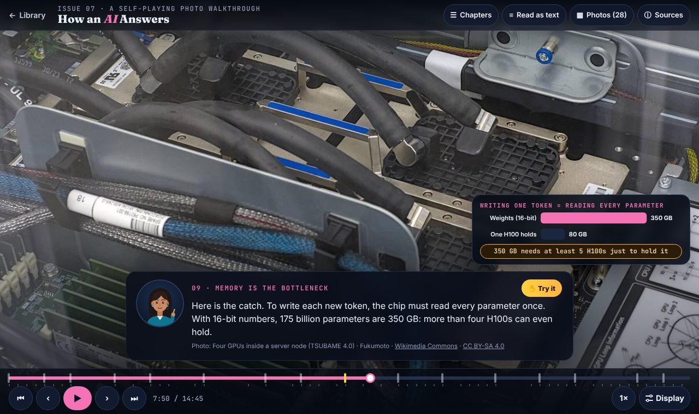

# The Cloud Cookbook

A free library of interactive, magazine-style explainers about how the cloud and AI really work, written in plain everyday language.
Each magazine has real photos, diagrams you can tap, small simulations and a quiz at the end of every chapter.

**Live library:** https://manish50.github.io/data_centers_cookbook/



## The magazines

| Issue | Magazine | Level | Chapters | Live link |
|---|---|---|---|---|
| 01 | **Inside the Cloud**: How a Data Center Really Works (self-playing photo walkthrough) | Beginner | 13 · about 13 min | https://manish50.github.io/data_centers_cookbook/data-centers/ |
| 02 | **Inside the Lakehouse**: Azure Databricks, from First Notebook to Architect | Beginner to Advanced | 21 · about 2 h | https://manish50.github.io/data_centers_cookbook/azure-databricks/ |
| 03 | **Inside the Mind of a Model**: How Claude Opus Is Built, Trained and Served | Beginner to Advanced | 25 · about 2½ h | https://manish50.github.io/data_centers_cookbook/ai-model/ |
| 04 | **How Netflix Streams**: from Play to pixels, a flying tour | Beginner to Intermediate | 15 stops · about 20 min | https://manish50.github.io/data_centers_cookbook/netflix-streaming/ |
| 05 | **From Sand to Signal**: how a chip is made, and how it lights a pixel (3D) | Beginner to Intermediate | 15 stops · about 25 min | https://manish50.github.io/data_centers_cookbook/sand-to-signal/ |
| 06 | **How the Internet Moves Data**: from your tap to the ocean floor (self-playing photo walkthrough) | Beginner to Intermediate | 14 · about 9 min | https://manish50.github.io/data_centers_cookbook/internet/ |
| 07 | **How an AI Answers**: from your message to the chips and back (self-playing photo walkthrough) | Beginner to Advanced | 16 · about 15 min | https://manish50.github.io/data_centers_cookbook/llm/ |

The home page remembers the last chapter you reached in each magazine and offers **Continue reading**.
That progress is stored only in your browser (`localStorage`), and every page still works when storage is blocked.

## Display settings and the guide

Every page has a **Display** button (on the home page too) with three switches, remembered for the whole library in this browser (`localStorage['cookbook:display']`):

| Switch | Off means | Key |
|---|---|---|
| **Guide** | the drawn presenter is hidden | G |
| **Text** | captions (Issues 01, 06) and card text (Issues 04, 05) are hidden; titles, interactive parts, sources and photo credits stay | C |
| **Voice** | nothing is read aloud | V |

Any mix works: the guide speaking with no text on screen, text with no guide, or text alone. Everything starts on.
- **Issues 01 and 06:** the guide sits in the caption box and reads every caption (the walkthrough waits for her).
- **Issues 04 and 05:** she is docked in the corner and reads each stop as it opens; **Listen** reads it again, and the Auto tour waits for her.
- **Issues 02 and 03:** **Listen** reads the magazine aloud from the paragraph you are on, highlighting each one (these pages have Guide and Voice switches; the magazine itself is the text).

She is a drawn character, not a real person. Her voice is your browser's built-in speech (Web Speech API), so it sounds different on each device, and browsers only allow it after your first tap or click. Code: `shared/display.js` (the setting and menu), `shared/anchor.js` (the guide), `shared/guide-dock.js` (docked guide and Listen), `shared/listen.js` (magazines). Tests: `node --test shared/tests/*.test.mjs` and `node shared/tests/e2e-display.mjs http://localhost:8765/`.

## How the site is organised

```
index.html                 library home page (magazine stand)
images/                    home-page images (README screenshot)
data-centers/              Issue 01: photo walkthrough (data.js, diagrams.js, main.js, photos/, tests/)
azure-databricks/index.html Issue 02, photos in azure-databricks/images/
ai-model/index.html        Issue 03, photos in ai-model/images/
netflix-streaming/         Issue 04: map tour (index.html, data.js, core.js, tour.js, tour.css, tests/)
sand-to-signal/            Issue 05: 3D tour (data.js, logic.js, scene.js, tour.js, tests/)
internet/                  Issue 06: photo walkthrough (data.js, diagrams.js, net.js, land.js, try.js, main.js, photos/, tests/)
llm/                       Issue 07: photo walkthrough (data.js, diagrams.js, lab.js, try.js, main.js, llm.css, photos/, tests/)
shared/                    the photo walkthrough player used by Issues 01 and 06: walkthrough.js/.css, timeline.js,
                           photos.js (pan, zoom, layout), anchor.js/.css (the speaking guide), diagram-kit.js,
                           prerender-kit.mjs, tests/
vendor/three.min.js        three.js r186, tree-shaken, used by Issue 05 (MIT, see vendor/LICENSE-three.txt)
sitemap.xml                list of pages for search engines
.nojekyll                  serve files as-is on GitHub Pages
```

Issues 02 and 03 are single self-contained `index.html` files (styles, scripts and diagrams inline) with their photos next to them. Issues 01, 04, 05 and 06 keep their content in a `data.js` file and pre-render a text version into `index.html`.
Every path is relative. The 2D magazines work when opened straight from disk; the 3D, map and photo tours use JavaScript modules, so serve the folder (for example `python3 -m http.server`).

### Adding a magazine

1. Create a folder, for example `my-topic/`, with its `index.html` and `images/` (include `images/cover-sm.jpg` and `images/cover-lg.jpg`).
2. Add an "All magazines" link to `../` in its top bar. To support Continue reading, save `localStorage['cookbook:my-topic'] = {id, num, title, at}` inside a try/catch.
3. Add one entry to the `MAGAZINES` list at the top of the script in the root `index.html`.

## Run it locally

No server or install needed: open `index.html` in any modern browser.
Fonts (Fraunces and Inter) load from Google Fonts when online, and the pages fall back to system fonts offline.

---

## Issue 01: Inside the Cloud



A self-playing walkthrough of a data center **in real photos**, about 13 minutes at 1×, in 13 chapters: what a data center is, the guided tour, servers and GPUs, the journey of a request, power and a full power cut, cooling and water, security and fire, redundancy and tiers, virtualization and the cloud, real-life traces, energy and the planet, and how data centers are planned, built and run.

**How it plays.** Like a film, every beat is a **real photo** filling the screen with a slow pan and zoom, a typed caption, labels pinned to parts of the photo, and stat cards for sourced numbers. A drawn **guide** in the caption box reads each caption aloud with your browser's built-in speech (Web Speech API): she picks a woman's English voice when the device has one, and the film waits for her if a beat ends before she does. The 🔊 button or **V** turns her off (remembered); browsers only allow speech after your first tap or click. She is a drawn character, not a real person, and her voice sounds different on each device.
Only ideas a camera can't see get **minimal animation**: a small flat diagram over the photo. **Photos** opens a gallery of every photo; tap one to jump to it (or link to `#photos`). Marks under the timeline show where each photo starts. Pause, scrub, jump to a chapter, change the speed or turn captions off at any time; reduced-motion settings stop autoplay and the pan and zoom.
Some photos are analogies (a library index for DNS, a railway yard for routers…); their titles say so. Every photo is from Wikimedia Commons under a free licence, credited below and in the Sources panel.

The whole walkthrough is also pre-rendered as text ("Read as text"). Chapter sections keep the old ids, so links like `../data-centers/#ch5` from the other magazines still land on the right chapter.

### Files

| File | What it holds |
|---|---|
| `data-centers/data.js` | **All content**: 13 chapters of beats (caption, length, `photo`, `focus`, `plabels`, `cue`, stat card), sources, recaps, and `PHOTOS` with every credit |
| `data-centers/diagrams.js` | The small flat diagrams (power chain, power cut, N / N+1 / 2N, the nines, PUE…), one per `cue` |
| `data-centers/photos/` | The photos (≤ 1400 px) and `photos/thumbs/` for the gallery |
| `data-centers/main.js` | Starts the shared player with this issue's content |
| `data-centers/prerender.mjs` | Writes the text version, Sources and photo credits into `index.html`, and versions every script and stylesheet (`?v=` content hash, plus an import map) so visitors always get fresh files |
| `shared/walkthrough.js` | The player: autoplay, scrubber, chapters, captions, photo layers, labels, diagrams, gallery, keyboard, text mode |

### Editing the walkthrough

- **Change a caption:** edit the beat's text in `data.js`, then run `node data-centers/prerender.mjs`.
- **Change a photo:** set the beat's `photo` to an id from `PHOTOS`. `focus: [u, v, zoom]` picks the part to centre (0–1 across and down) and how far to zoom; `plabels: [[text, [u, v]]]` pins labels to the photo.
- **Add a photo:** put a JPG (≤ 1400 px) in `photos/` and a 240×160 thumbnail in `photos/thumbs/`, and add it to `PHOTOS` with its Wikimedia Commons page, author and licence. The unit tests check every beat has a photo and every photo has a free licence and credit.
- **Re-time it:** each beat has `d`, its length in seconds (8.5 by default). Open `data-centers/?paused#t=SECONDS` to look at one moment.

### Tests

```bash
node --test data-centers/tests/*.test.mjs shared/tests/*.test.mjs
node data-centers/tests/e2e.mjs http://localhost:8765/
```

### Sources

Every number on a stat card comes from the original magazine's checked sources: the IEA (*Energy and AI*, 2025), the Uptime Institute, Google, Microsoft, LBNL, NVIDIA and Supermicro specifications, NPCI, NRDC, ASHRAE, NFPA 2001 and the LTO Program. The full list is in the walkthrough's Sources panel and at the end of the text version.

### Photo credits: Inside the Cloud

From Wikimedia Commons, resized for the web:

- **Coins: every payment is a small piece of data**: Роман Рябенко, [Wikimedia Commons](https://commons.wikimedia.org/wiki/File:A_pile_of_Ukrainian_currency_coins.jpg), [CC0](https://creativecommons.org/publicdomain/zero/1.0/deed.en)
- **A large data center campus (The Dalles, Oregon)**: Tony Webster from Minneapolis, Minnesota, United States, [Wikimedia Commons](https://commons.wikimedia.org/wiki/File:Google_Datacenter_-_The_Dalles,_Oregon_(17832143871).jpg), [CC BY 2.0](https://creativecommons.org/licenses/by/2.0)
- **A server hall at CERN, Geneva**: Florian Hirzinger - www.fh-ap.com, [Wikimedia Commons](https://commons.wikimedia.org/wiki/File:CERN_Server_03.jpg), [CC BY-SA 3.0](https://creativecommons.org/licenses/by-sa/3.0)
- **CERN’s data centre building**: Unnerving duck, [Wikimedia Commons](https://commons.wikimedia.org/wiki/File:CERN_data_centre.jpg), [CC BY-SA 4.0](https://creativecommons.org/licenses/by-sa/4.0)
- **Cooling towers on a data center (Mesa, Arizona)**: Rsparks3, [Wikimedia Commons](https://commons.wikimedia.org/wiki/File:Data_center_cooling_tower.jpg), [CC0](https://creativecommons.org/publicdomain/zero/1.0/deed.en)
- **A data center campus from the air (Mayes County, Oklahoma)**: Xpda, [Wikimedia Commons](https://commons.wikimedia.org/wiki/File:Google_Mayes_County_P0004974a.jpg), [CC BY-SA 4.0](https://creativecommons.org/licenses/by-sa/4.0)
- **Server racks at the Wikimedia Foundation**: Victor Grigas, [Wikimedia Commons](https://commons.wikimedia.org/wiki/File:Wikimedia_Foundation_Servers-8055_35.jpg), [CC BY-SA 3.0](https://creativecommons.org/licenses/by-sa/3.0)
- **ENIAC, one of the first big computers (1940s)**: U.S. Army (photographer unknown), [Wikimedia Commons](https://commons.wikimedia.org/wiki/File:Glen_Beck_and_Betty_Snyder_program_the_ENIAC_in_building_328_at_the_Ballistic_Research_Laboratory.jpg), Public domain
- **A supercomputer hall (IBM Blue Gene/P, Argonne)**: Argonne National Laboratory, [Wikimedia Commons](https://commons.wikimedia.org/wiki/File:IBM_Blue_Gene_P_supercomputer.jpg), [CC BY-SA 2.0](https://creativecommons.org/licenses/by-sa/2.0)
- **Cooling units on a raised floor**: Robert.Harker, [Wikimedia Commons](https://commons.wikimedia.org/wiki/File:CRAC_Cabinets_2.jpg), [CC BY-SA 3.0](https://creativecommons.org/licenses/by-sa/3.0)
- **Racks full of servers**: BalticServers.com, [Wikimedia Commons](https://commons.wikimedia.org/wiki/File:BalticServers_data_center.jpg), [CC BY-SA 3.0](https://creativecommons.org/licenses/by-sa/3.0)
- **The Library of Congress reading room**: Carol M. Highsmith, [Wikimedia Commons](https://commons.wikimedia.org/wiki/File:LOC_Main_Reading_Room_Highsmith.jpg), Public domain
- **A magnetic tape library, decades ago (US Department of Agriculture)**: U.S. Department of Agriculture, [Wikimedia Commons](https://commons.wikimedia.org/wiki/File:Magnetic_tape_library_at_USDA.jpg), [CC BY 2.0](https://creativecommons.org/licenses/by/2.0)
- **Rack servers (Wikimedia Foundation)**: Victor Grigas, [Wikimedia Commons](https://commons.wikimedia.org/wiki/File:Wikimedia_Foundation_Servers-8055_08.jpg), [CC BY-SA 3.0](https://creativecommons.org/licenses/by-sa/3.0)
- **Network switches and their cables**: ShakataGaNai, [Wikimedia Commons](https://commons.wikimedia.org/wiki/File:Network_switches.jpg), [CC BY-SA 3.0](https://creativecommons.org/licenses/by-sa/3.0)
- **Network cabling in a data center**: Victor Grigas, [Wikimedia Commons](https://commons.wikimedia.org/wiki/File:Wikimedia_Foundation_Servers-8055_24.jpg), [CC BY-SA 3.0](https://creativecommons.org/licenses/by-sa/3.0)
- **Rows of servers (Wikimedia Foundation)**: Victor Grigas, [Wikimedia Commons](https://commons.wikimedia.org/wiki/File:Wikimedia_Foundation_Servers-8055_13.jpg), [CC BY-SA 3.0](https://creativecommons.org/licenses/by-sa/3.0)
- **A blade chassis: thin servers sharing one box**: Redline, [Wikimedia Commons](https://commons.wikimedia.org/wiki/File:HP_c7000-1.jpg), [CC BY-SA 3.0](https://creativecommons.org/licenses/by-sa/3.0)
- **Inside a 1U server, lid off**: Rodzilla at English Wikipedia, [Wikimedia Commons](https://commons.wikimedia.org/wiki/File:Inside_and_Rear_of_Webserver.jpg), [CC BY 2.5](https://creativecommons.org/licenses/by/2.5)
- **Web and application servers (Wikimedia Foundation)**: Victor Grigas, [Wikimedia Commons](https://commons.wikimedia.org/wiki/File:Wikimedia_Foundation_Servers-8055_17.jpg), [CC BY-SA 3.0](https://creativecommons.org/licenses/by-sa/3.0)
- **A mobile phone mast**: Diacius, [Wikimedia Commons](https://commons.wikimedia.org/wiki/File:Mobile_phone_mast.jpg), [CC BY-SA 4.0](https://creativecommons.org/licenses/by-sa/4.0)
- **Four GPUs inside a server node (TSUBAME 4.0)**: Fukumoto, [Wikimedia Commons](https://commons.wikimedia.org/wiki/File:TSUBAME4.0_P5160984.jpg), [CC BY-SA 4.0](https://creativecommons.org/licenses/by-sa/4.0)
- **A supercomputer node (TSUBAME 4.0)**: Fukumoto, [Wikimedia Commons](https://commons.wikimedia.org/wiki/File:TSUBAME4.0_P5160989.jpg), [CC BY-SA 4.0](https://creativecommons.org/licenses/by-sa/4.0)
- **A rack-scale AI system (NVIDIA GB200 NVL72)**: Pokiiri, [Wikimedia Commons](https://commons.wikimedia.org/wiki/File:Nvidia_DGX_GB200.jpg), [CC BY-SA 4.0](https://creativecommons.org/licenses/by-sa/4.0)
- **A library card catalogue: an index for finding things**: Michael Holley Swtpc6800, [Wikimedia Commons](https://commons.wikimedia.org/wiki/File:Copyright_Card_Catalog_Drawer.jpg), Public domain
- **Optical fibre carrying light**: Hustvedt, [Wikimedia Commons](https://commons.wikimedia.org/wiki/File:Fiber_optic_illuminated.jpg), [CC BY-SA 3.0](https://creativecommons.org/licenses/by-sa/3.0)
- **Air traffic control: directing traffic**: Senior Airman John Wright, [Wikimedia Commons](https://commons.wikimedia.org/wiki/File:Lajes_Field_Air_Traffic_Control.jpg), Public domain
- **Real undersea cable samples, heavy armour to lightweight**: Lonnie Hagadorn, [Wikimedia Commons](https://commons.wikimedia.org/wiki/File:Submarine_Optical_Cables.jpg), [CC BY-SA 4.0](https://creativecommons.org/licenses/by-sa/4.0)
- **A reservoir (Lemon Reservoir, Colorado)**: Radomianin, [Wikimedia Commons](https://commons.wikimedia.org/wiki/File:Lemon_Reservoir,_Colorado.jpg), [CC BY-SA 4.0](https://creativecommons.org/licenses/by-sa/4.0)
- **A substation transformer (Liverpool)**: Rept0n1x, [Wikimedia Commons](https://commons.wikimedia.org/wiki/File:Electrical_substation_transformer,_Love_Lane,_Liverpool.JPG), [CC BY-SA 3.0](https://creativecommons.org/licenses/by-sa/3.0)
- **Medium-voltage switchgear cabinets**: Zen 38, [Wikimedia Commons](https://commons.wikimedia.org/wiki/File:Medium_voltage_panel.jpg), [CC BY-SA 3.0](https://creativecommons.org/licenses/by-sa/3.0)
- **A row of UPS cabinets**: Robert.Harker, [Wikimedia Commons](https://commons.wikimedia.org/wiki/File:EPS_6000_Row_B.jpg), [CC BY-SA 3.0](https://creativecommons.org/licenses/by-sa/3.0)
- **UPS batteries in a data center**: Jelson25, [Wikimedia Commons](https://commons.wikimedia.org/wiki/File:Datacenter_Backup_Batteries.jpg), [CC BY 3.0](https://creativecommons.org/licenses/by/3.0)
- **Generators at a nearly finished data center**: Lapalmauz, [Wikimedia Commons](https://commons.wikimedia.org/wiki/File:Una_batteria_di_grossi_generatori_alimentati_a_gasolio_in_un_Data_Center_in_via_di_ultimazione.jpg), [CC BY-SA 4.0](https://creativecommons.org/licenses/by-sa/4.0)
- **Wind turbines and power lines, East Sussex**: Diliff, [Wikimedia Commons](https://commons.wikimedia.org/wiki/File:Wind_Turbines_and_Power_Lines,_East_Sussex,_England_-_April_2009.jpg), [CC BY-SA 3.0](https://creativecommons.org/licenses/by-sa/3.0)
- **A cold aisle between two rows of racks**: Robert.Harker, [Wikimedia Commons](https://commons.wikimedia.org/wiki/File:Cabinet_Asile.jpg), [CC BY-SA 3.0](https://creativecommons.org/licenses/by-sa/3.0)
- **A big plant room with pumps and pipes (NASA Glenn Research Center)**: NASA/GRC/Jef Janis, [Wikimedia Commons](https://commons.wikimedia.org/wiki/File:GRC-2023-C-11335.jpg), Public domain
- **A liquid-cooled AI chip board (Google TPU v3)**: Zinskauf, [Wikimedia Commons](https://commons.wikimedia.org/wiki/File:Tensor_Processing_Unit_3.0.jpg), [CC BY-SA 4.0](https://creativecommons.org/licenses/by-sa/4.0)
- **Pipework in an industrial plant room**: Eric Jusino from Denver, CO, USA, [Wikimedia Commons](https://commons.wikimedia.org/wiki/File:Gates_Rubber,_interior_pipelines.jpg), [CC BY 2.0](https://creativecommons.org/licenses/by/2.0)
- **A locked customer cage**: Virtuo Doc, [Wikimedia Commons](https://commons.wikimedia.org/wiki/File:Cage_Quelle_EMC_HostCo_GmbH.jpg), [CC BY-SA 4.0](https://creativecommons.org/licenses/by-sa/4.0)
- **A gas fire-suppression discharge**: Keith4048, [Wikimedia Commons](https://commons.wikimedia.org/wiki/File:COMPUTER_ROOM_DISCHARGE.JPG), Public domain
- **Code on a screen: software watching the machines**: Markus Spiske markusspiske, [Wikimedia Commons](https://commons.wikimedia.org/wiki/File:Code_on_computer_monitor_(Unsplash).jpg), [CC0](https://creativecommons.org/publicdomain/zero/1.0/deed.en)
- **A Formula One wheel gun: spares changed in seconds**: Rich Jones from United Kingdom, [Wikimedia Commons](https://commons.wikimedia.org/wiki/File:Formula_One_Wheel_Gun.jpg), [CC BY 2.0](https://creativecommons.org/licenses/by/2.0)
- **Container cranes: goods packed into standard boxes**: Calistemon, [Wikimedia Commons](https://commons.wikimedia.org/wiki/File:Container_cranes_in_Fremantle_Harbour,_July_2023_01.jpg), [CC BY-SA 4.0](https://creativecommons.org/licenses/by-sa/4.0)
- **Inside a computing rack (Ifremer’s Datarmor centre)**: Gregory Rocher / Ifremer, [Wikimedia Commons](https://commons.wikimedia.org/wiki/File:Le_Centre_Datarmor,_les_coulisses_(Ifremer_00957-106840_-_54954).jpg), [CC BY 4.0](https://creativecommons.org/licenses/by/4.0)
- **District heating pipes being laid (Jyväskylä, Finland)**: Antti Leppänen, [Wikimedia Commons](https://commons.wikimedia.org/wiki/File:District_heating_pipes_in_Jyv%C3%A4skyl%C3%A4.jpg), [CC BY-SA 3.0](https://creativecommons.org/licenses/by-sa/3.0)
- **A silicon wafer full of chips**: Enrique Jiménez, [Wikimedia Commons](https://commons.wikimedia.org/wiki/File:Silicon_Wafer_20190210.jpg), [CC BY-SA 2.0](https://creativecommons.org/licenses/by-sa/2.0)
- **A blueprint: every building starts as a plan**: Alice Trythall Washburn, [Wikimedia Commons](https://commons.wikimedia.org/wiki/File:Blueprint_of_elevation_by_Alice_Trythall_Washburn.jpg), Public domain
- **A load bank testing a generator**: Wtshymanski, [Wikimedia Commons](https://commons.wikimedia.org/wiki/File:Air_cooled_load_bank.jpg), [CC BY-SA 4.0](https://creativecommons.org/licenses/by-sa/4.0)
- **A technician at work on network equipment**: Bill Branson (Photographer), [Wikimedia Commons](https://commons.wikimedia.org/wiki/File:Network_server_and_technician.jpg), Public domain
- **Pilots working through a checklist**: U.S. Air Force photo/Staff Sgt. Chris Willis, [Wikimedia Commons](https://commons.wikimedia.org/wiki/File:120316-F-LR266-986_C-130J_Hercules_Cockpit_Ramstein_Air_Base_2012.jpg), Public domain

---

## Issue 02: Inside the Lakehouse



A guide to Azure Databricks for data engineers and architects, from "What is Databricks?" to a production-ready design.
Chapters are marked **Beginner**, **Intermediate** or **Advanced**, and a learning path at the start shows three tracks.
Every chapter has an **Inside the data center** panel: a short summary with a "See inside" button that opens up the physical side. It covers where the work runs, which Azure VM families it uses, how the data travels, power and heat, scale, what happens when something breaks, and how it would feel to stand there. It also has a "Go deeper" link into the matching chapter of Issue 01.

| # | Chapter | Level | Try it |
|---|---|---|---|
| 01 | What is Databricks? | Beginner | Persona picker |
| 02 | Lake, warehouse, lakehouse | Beginner | "Where would you keep it?" sorter |
| 03 | The architecture | Beginner | Architecture explorer |
| 04 | Its neighbours in Azure | Beginner | Azure neighbourhood map |
| 05 | Compute: choosing your engine | Beginner | "Which compute?" chooser |
| 06 | Spark basics | Beginner | Spark job animation with executor slider |
| 07 | Delta Lake | Intermediate | Time-travel slider + VACUUM |
| 08 | Medallion architecture | Intermediate | Bronze → silver → gold animation |
| 09 | Getting data in | Intermediate | Auto Loader demo + ingestion picker |
| 10 | Building pipelines | Intermediate | Batch vs streaming toggle, expectations demo |
| 11 | Structured Streaming | Intermediate | Watermark / late-data slider |
| 12 | Orchestration | Intermediate | Job DAG with failure, retry and repair |
| 13 | Unity Catalog | Intermediate | Catalog explorer: who can see what |
| 14 | Databricks SQL and dashboards | Intermediate | Rush-hour SQL warehouse demo |
| 15 | Performance tuning | Advanced | Data skew demo (AQE, salting) |
| 16 | Cost control | Advanced | Cluster cost estimator (example prices) |
| 17 | Security and networking | Advanced | Network lock-down in 4 steps |
| 18 | DevOps | Advanced | dev → test → prod promotion |
| 19 | ML and AI | Advanced | MLflow lifecycle stepper |
| 20 | Reference architectures | Advanced | Architecture switcher |
| 21 | Mistakes and the architect checklist | Advanced | Production-readiness checklist |

Product names follow the current Microsoft Learn and Databricks documentation (checked November 2026):
- Lakeflow Spark Declarative Pipelines (formerly Delta Live Tables)
- Lakeflow Jobs (formerly Workflows)
- Declarative Automation Bundles (formerly Databricks Asset Bundles)
- OpenSharing (formerly Delta Sharing)
- Git folders
- Standard / Dedicated access modes

Prices in the cost estimator are **examples** from the Azure Databricks pricing page (Premium, pay-as-you-go, US East). Prices change, so it is not a quote.

This is an independent educational guide. It is not affiliated with or endorsed by Microsoft or Databricks, and it uses no official logos or diagrams. All diagrams were drawn for this site.

### Sources: Inside the Lakehouse

- [What is Azure Databricks?](https://learn.microsoft.com/en-us/azure/databricks/introduction/)
- [High-level architecture](https://learn.microsoft.com/en-us/azure/databricks/getting-started/high-level-architecture)
- [End of life for Standard tier workspaces](https://learn.microsoft.com/en-us/azure/databricks/admin/account-settings/standard-tier)
- [Compute](https://learn.microsoft.com/en-us/azure/databricks/compute/)
- [Compute configuration](https://learn.microsoft.com/en-us/azure/databricks/compute/configure)
- [Photon](https://learn.microsoft.com/en-us/azure/databricks/compute/photon)
- [SQL warehouse types](https://learn.microsoft.com/en-us/azure/databricks/compute/sql-warehouse/warehouse-types)
- [SQL warehouse sizing and scaling](https://learn.microsoft.com/en-us/azure/databricks/compute/sql-warehouse/warehouse-behavior)
- [Table history and time travel](https://learn.microsoft.com/en-us/azure/databricks/delta/history)
- [VACUUM](https://learn.microsoft.com/en-us/azure/databricks/delta/vacuum)
- [MERGE](https://learn.microsoft.com/en-us/azure/databricks/delta/merge)
- [Liquid clustering](https://learn.microsoft.com/en-us/azure/databricks/delta/clustering)
- [Predictive optimization](https://learn.microsoft.com/en-us/azure/databricks/optimizations/predictive-optimization)
- [Medallion architecture](https://learn.microsoft.com/en-us/azure/databricks/lakehouse/medallion)
- [Auto Loader](https://learn.microsoft.com/en-us/azure/databricks/ingestion/cloud-object-storage/auto-loader/)
- [COPY INTO](https://learn.microsoft.com/en-us/azure/databricks/ingestion/copy-into/)
- [Lakeflow Connect](https://learn.microsoft.com/en-us/azure/databricks/ingestion/lakeflow-connect/)
- [Lakeflow Spark Declarative Pipelines](https://learn.microsoft.com/en-us/azure/databricks/ldp/)
- [What happened to DLT?](https://learn.microsoft.com/en-us/azure/databricks/ldp/concepts/where-is-dlt)
- [Expectations](https://learn.microsoft.com/en-us/azure/databricks/ldp/expectations)
- [Triggers](https://learn.microsoft.com/en-us/azure/databricks/structured-streaming/triggers)
- [Watermarks](https://learn.microsoft.com/en-us/azure/databricks/structured-streaming/watermarks)
- [Lakeflow Jobs](https://learn.microsoft.com/en-us/azure/databricks/jobs/)
- [Unity Catalog](https://learn.microsoft.com/en-us/azure/databricks/data-governance/unity-catalog/)
- [OpenSharing](https://learn.microsoft.com/en-us/azure/databricks/delta-sharing/)
- [Secure cluster connectivity](https://learn.microsoft.com/en-us/azure/databricks/security/network/classic/secure-cluster-connectivity)
- [VNet injection](https://learn.microsoft.com/en-us/azure/databricks/security/network/classic/vnet-inject)
- [Private Link](https://learn.microsoft.com/en-us/azure/databricks/security/network/classic/private-link)
- [Secrets](https://learn.microsoft.com/en-us/azure/databricks/security/secrets/)
- [Adaptive Query Execution](https://learn.microsoft.com/en-us/azure/databricks/optimizations/aqe)
- [Disk cache](https://learn.microsoft.com/en-us/azure/databricks/optimizations/disk-cache)
- [Git folders](https://learn.microsoft.com/en-us/azure/databricks/repos/)
- [Declarative Automation Bundles](https://learn.microsoft.com/en-us/azure/databricks/dev-tools/bundles/)
- [Bundles release notes (rename, March 2026)](https://docs.databricks.com/aws/en/release-notes/dev-tools/bundles)
- [MLflow](https://learn.microsoft.com/en-us/azure/databricks/mlflow/)
- [Model Serving](https://learn.microsoft.com/en-us/azure/databricks/machine-learning/model-serving/)
- [Agent Bricks](https://learn.microsoft.com/en-us/azure/databricks/generative-ai/agent-bricks/)
- [AI/BI dashboards](https://learn.microsoft.com/en-us/azure/databricks/dashboards/)
- [Genie](https://learn.microsoft.com/en-us/azure/databricks/genie/)
- [Power BI](https://learn.microsoft.com/en-us/azure/databricks/partners/bi/power-bi)
- [VM sizes](https://learn.microsoft.com/en-us/azure/virtual-machines/sizes/overview)
- [Ddsv5](https://learn.microsoft.com/en-us/azure/virtual-machines/sizes/general-purpose/ddsv5-series)
- [Edsv5](https://learn.microsoft.com/en-us/azure/virtual-machines/sizes/memory-optimized/edsv5-series)
- [Fsv2](https://learn.microsoft.com/en-us/azure/virtual-machines/sizes/compute-optimized/fsv2-series)
- [Lsv3](https://learn.microsoft.com/en-us/azure/virtual-machines/sizes/storage-optimized/lsv3-series)
- [ND H100 v5](https://learn.microsoft.com/en-us/azure/virtual-machines/sizes/gpu-accelerated/ndh100v5-series)
- [Storage redundancy](https://learn.microsoft.com/en-us/azure/storage/common/storage-redundancy)
- [Availability zones](https://learn.microsoft.com/en-us/azure/reliability/availability-zones-overview)
- [Azure Spot VMs](https://learn.microsoft.com/en-us/azure/virtual-machines/spot-vms)
- [Azure Databricks pricing](https://azure.microsoft.com/en-us/pricing/details/databricks/)
- [Databricks Runtime release notes](https://docs.databricks.com/aws/en/release-notes/runtime/)
- [Lakeflow Jobs (formerly Workflows)](https://www.databricks.com/blog/whats-new-lakeflow-jobs-provides-more-efficient-data-orchestration)

### Photo credits: Inside the Lakehouse

All photos come from [Wikimedia Commons](https://commons.wikimedia.org/) under the free licences below (several are shared with Issue 01). They were resized and compressed for the web, and some were cropped; adapted versions keep the same licence.
A machine-readable list is in [`azure-databricks/images/credits.json`](azure-databricks/images/credits.json).

| Used for | Photo | Author | Licence |
|---|---|---|---|
| Cover: a stilt house in Lake Dojran | [Наколно живеалиште во Дојранско Езеро](https://commons.wikimedia.org/wiki/File:%D0%9D%D0%B0%D0%BA%D0%BE%D0%BB%D0%BD%D0%BE_%D0%B6%D0%B8%D0%B2%D0%B5%D0%B0%D0%BB%D0%B8%D1%88%D1%82%D0%B5_%D0%B2%D0%BE_%D0%94%D0%BE%D1%98%D1%80%D0%B0%D0%BD%D1%81%D0%BA%D0%BE_%D0%95%D0%B7%D0%B5%D1%80%D0%BE.jpg) | Kiril Simeonovski | [CC BY-SA 4.0](https://creativecommons.org/licenses/by-sa/4.0) |
| Ch 1 opening: server hall at CERN | [CERN Server 03](https://commons.wikimedia.org/wiki/File:CERN_Server_03.jpg) | Florian Hirzinger - www.fh-ap.com | [CC BY-SA 3.0](https://creativecommons.org/licenses/by-sa/3.0) |
| Ch 1 inside panel: rows of Wikimedia Foundation servers | [Wikimedia Foundation Servers-8055 08](https://commons.wikimedia.org/wiki/File:Wikimedia_Foundation_Servers-8055_08.jpg) | Victor Grigas | [CC BY-SA 3.0](https://creativecommons.org/licenses/by-sa/3.0) |
| Ch 2 opening: lake with a house on its shore | [Lake at summer scenic white house on shore in background](https://commons.wikimedia.org/wiki/File:Lake_at_summer_scenic_white_house_on_shore_in_background.jpg) | U.S. Fish and Wildlife Service | Public domain |
| Ch 2 inside panel: storage system at Ifremer's Datarmor centre | [Le Centre Datarmor, les coulisses (Ifremer 00957-106840 - 54953)](https://commons.wikimedia.org/wiki/File:Le_Centre_Datarmor,_les_coulisses_(Ifremer_00957-106840_-_54953).jpg) | Gregory Rocher / Ifremer | [CC BY 4.0](https://creativecommons.org/licenses/by/4.0) |
| Ch 3 opening: Google data center campus, Mayes County, Oklahoma | [Google Mayes County P0004974a](https://commons.wikimedia.org/wiki/File:Google_Mayes_County_P0004974a.jpg) | Xpda | [CC BY-SA 4.0](https://creativecommons.org/licenses/by-sa/4.0) |
| Ch 4 opening: illuminated optical fibres | [Fiber optic illuminated](https://commons.wikimedia.org/wiki/File:Fiber_optic_illuminated.jpg) | Hustvedt | [CC BY-SA 3.0](https://creativecommons.org/licenses/by-sa/3.0) |
| Ch 5 opening: Dell servers in a rack (Wikimedia) | [Wikimedia Foundation Servers-8055 43](https://commons.wikimedia.org/wiki/File:Wikimedia_Foundation_Servers-8055_43.jpg) | Victor Grigas | [CC BY-SA 3.0](https://creativecommons.org/licenses/by-sa/3.0) |
| Ch 6 opening: Wikimedia Foundation servers | [Wikimedia Foundation Servers-8055 13](https://commons.wikimedia.org/wiki/File:Wikimedia_Foundation_Servers-8055_13.jpg) | Victor Grigas | [CC BY-SA 3.0](https://creativecommons.org/licenses/by-sa/3.0) |
| Ch 7 opening: library bookstacks, 1904 | [Bookstacks1904 - DPLA - b3cd3f1ec1091fd385286151c2e6e417](https://commons.wikimedia.org/wiki/File:Bookstacks1904_-_DPLA_-_b3cd3f1ec1091fd385286151c2e6e417.jpg) | Brackett, J. Raymond | Public domain |
| Ch 8 opening: 1996 Summer Olympics medals | [1996 Summer Olympics medals, Atlanta History Center](https://commons.wikimedia.org/wiki/File:1996_Summer_Olympics_medals,_Atlanta_History_Center.jpg) | JJonahJackalope | [CC BY-SA 4.0](https://creativecommons.org/licenses/by-sa/4.0) |
| Ch 9 opening: Lemon Reservoir, Colorado | [Lemon Reservoir, Colorado](https://commons.wikimedia.org/wiki/File:Lemon_Reservoir,_Colorado.jpg) | Radomianin | [CC BY-SA 4.0](https://creativecommons.org/licenses/by-sa/4.0) |
| Ch 10 opening: interior pipelines, Gates Rubber | [Gates Rubber, interior pipelines](https://commons.wikimedia.org/wiki/File:Gates_Rubber,_interior_pipelines.jpg) | Eric Jusino from Denver, CO, USA | [CC BY 2.0](https://creativecommons.org/licenses/by/2.0) |
| Ch 11 opening: fast mountain river | [Fast mountain river flowing through the conifer forest](https://commons.wikimedia.org/wiki/File:Fast_mountain_river_flowing_through_the_conifer_forest.jpg) | Smith Michael L, U.S. Fish and Wildlife Service | Public domain |
| Ch 12 opening: CSX train switching, Framingham North Yard | [CSX train switching at Framingham North Yard June 2026](https://commons.wikimedia.org/wiki/File:CSX_train_switching_at_Framingham_North_Yard_June_2026.jpg) | 4300streetcar | [CC BY 4.0](https://creativecommons.org/licenses/by/4.0) |
| Ch 13 opening: card catalog drawer, Library of Congress | [Copyright Card Catalog Drawer](https://commons.wikimedia.org/wiki/File:Copyright_Card_Catalog_Drawer.jpg) | Michael Holley Swtpc6800 | Public domain |
| Ch 14 opening: KC-135 Stratotanker cockpit | [KC-135 Stratotanker Cockpit](https://commons.wikimedia.org/wiki/File:KC-135_Stratotanker_Cockpit.JPG) | Unknown | Public domain |
| Ch 15 opening: Formula One wheel gun | [Formula One Wheel Gun](https://commons.wikimedia.org/wiki/File:Formula_One_Wheel_Gun.jpg) | Rich Jones from United Kingdom | [CC BY 2.0](https://creativecommons.org/licenses/by/2.0) |
| Ch 16 opening: a pile of coins | [A pile of Ukrainian currency coins](https://commons.wikimedia.org/wiki/File:A_pile_of_Ukrainian_currency_coins.jpg) | Роман Рябенко | [CC0](http://creativecommons.org/publicdomain/zero/1.0/deed.en) |
| Ch 17 opening: locked customer cage in a data center | [Cage Quelle EMC HostCo GmbH](https://commons.wikimedia.org/wiki/File:Cage_Quelle_EMC_HostCo_GmbH.jpg) | Virtuo Doc | [CC BY-SA 4.0](https://creativecommons.org/licenses/by-sa/4.0) |
| Ch 18 opening: container cranes, Fremantle Harbour | [Container cranes in Fremantle Harbour, July 2023 01](https://commons.wikimedia.org/wiki/File:Container_cranes_in_Fremantle_Harbour,_July_2023_01.jpg) | Calistemon | [CC BY-SA 4.0](https://creativecommons.org/licenses/by-sa/4.0) |
| Ch 19 opening: NVIDIA HGX B200 GPU board | [Nvidia DGX-B200-HGX](https://commons.wikimedia.org/wiki/File:Nvidia_DGX-B200-HGX.jpg) | Pokiiri | [CC BY-SA 4.0](https://creativecommons.org/licenses/by-sa/4.0) |
| Ch 20 opening: blueprint of an elevation | [Blueprint of elevation by Alice Trythall Washburn](https://commons.wikimedia.org/wiki/File:Blueprint_of_elevation_by_Alice_Trythall_Washburn.jpg) | Alice Trythall Washburn | Public domain |
| Ch 21 opening: pilots in a C-130J cockpit | [120316-F-LR266-986 C-130J Hercules Cockpit Ramstein Air Base 2012](https://commons.wikimedia.org/wiki/File:120316-F-LR266-986_C-130J_Hercules_Cockpit_Ramstein_Air_Base_2012.jpg) | U.S. Air Force photo/Staff Sgt. Chris Willis | Public domain |
| Finale: stilt house in Lake Dojran | [Наколно живеалиште во Дојранско Езеро](https://commons.wikimedia.org/wiki/File:%D0%9D%D0%B0%D0%BA%D0%BE%D0%BB%D0%BD%D0%BE_%D0%B6%D0%B8%D0%B2%D0%B5%D0%B0%D0%BB%D0%B8%D1%88%D1%82%D0%B5_%D0%B2%D0%BE_%D0%94%D0%BE%D1%98%D1%80%D0%B0%D0%BD%D1%81%D0%BA%D0%BE_%D0%95%D0%B7%D0%B5%D1%80%D0%BE.jpg) | Kiril Simeonovski | [CC BY-SA 4.0](https://creativecommons.org/licenses/by-sa/4.0) |

---

## Issue 03: Inside the Mind of a Model



> **An independent explainer. Not affiliated with or endorsed by Anthropic.**

How a large AI model like Claude Opus is created, trained, served on real hardware and used to build applications, from a single token to liquid-cooled AI racks.
It has its own "night lab" look (with a light reading mode): hooks that stream in token by token, a living network on the cover, diagrams that stay pinned while you scroll, "Not public" redaction bars, a context-window reading meter and a searchable chapter map.

Every fact carries one of three labels:
- **Anthropic has said ↗**: published by Anthropic (or a named cloud/chip partner), with a link to the source.
- **How models like this work**: general knowledge about language models.
- **Illustration**: a simplified demo made for teaching.

Numbers Anthropic hasn't published, such as parameter counts, training data size, chip counts and training cost, are never guessed: the magazine shows them as "Not public". Models, features, platforms and prices were checked on Anthropic's website on 9 November 2026. Every chapter has an **Inside the data center** panel linking into Issue 01.

| # | Chapter | Level | Try it |
|---|---|---|---|
| 01 | What is a large language model? | Beginner | Next-word game |
| 02 | Meet the Claude family | Beginner | “Which model for which job?” picker |
| 03 | Training data | Beginner | Keep / fix / drop data sorter |
| 04 | Tokens | Beginner | Tokenizer demo |
| 05 | The Transformer | Intermediate | Pinned scroll story, attention explorer, word-meaning map |
| 06 | Pre-training | Intermediate | Training animation (loss curve) |
| 07 | Post-training | Intermediate | “Which answer is better?” preference picker |
| 08 | Safety work | Intermediate | Responsible Scaling Policy stepper, feature explorer |
| 09 | Why AI needs special chips | Beginner | CPU vs accelerator race |
| 10 | Inside an AI server | Intermediate | AI server explorer |
| 11 | Training clusters | Advanced | Scale explorer: laptop → cluster |
| 12 | Power and cooling for AI | Intermediate | Rack power slider: air vs liquid |
| 13 | Training vs inference | Intermediate | Side-by-side toggle |
| 14 | The journey of one message | Beginner | Message journey animation |
| 15 | Context, sampling, streaming, thinking | Intermediate | Context window demo, temperature slider |
| 16 | Serving millions of users | Advanced | Batching simulator |
| 17 | Where you can use Claude | Beginner | Platform chooser |
| 18 | Claude API basics | Intermediate | Python/JS code, cost estimator with current prices |
| 19 | Prompting well | Beginner | Prompt fixer |
| 20 | Tools, agents and MCP | Intermediate | Agent loop simulator, tool-call code |
| 21 | Retrieval (RAG) | Intermediate | “Ask your documents” demo |
| 22 | Faster and cheaper | Advanced | Prompt caching savings calculator |
| 23 | Claude Code | Intermediate | Coding-session replay with permission modes |
| 24 | Example architectures | Advanced | Architecture switcher incl. Azure Data Factory assistant via Microsoft Foundry |
| 25 | Testing, limits and responsible use | Advanced | Spot the made-up answer, readiness checklist |

No Anthropic or Claude logos, website designs, images or diagrams are used. All diagrams, animations and the cover artwork were drawn for this magazine.

### Sources: Inside the Mind of a Model

- [System Card: Claude Opus 5.5](https://anthropic.com/claude-opus-5-5-system-card)
- [Introducing Claude Opus 5.5](https://www.anthropic.com/news/claude-opus-5-5)
- [Claude’s Constitution](https://www.anthropic.com/constitution)
- [Constitutional AI: Harmlessness from AI Feedback](https://www.anthropic.com/research/constitutional-ai-harmlessness-from-ai-feedback)
- [Anthropic’s Responsible Scaling Policy](https://www.anthropic.com/responsible-scaling-policy)
- [Mapping the mind of a large language model](https://www.anthropic.com/research/mapping-mind-language-model)
- [Tracing the thoughts of a large language model](https://www.anthropic.com/research/tracing-thoughts-language-model)
- [Building effective AI agents](https://www.anthropic.com/engineering/building-effective-agents)
- [Contextual retrieval in AI systems](https://www.anthropic.com/news/contextual-retrieval)
- [Expanding our use of Google Cloud TPUs and Services](https://www.anthropic.com/news/expanding-our-use-of-google-cloud-tpus-and-services)
- [Anthropic invests $50 billion in American AI infrastructure](https://www.anthropic.com/news/anthropic-invests-50-billion-in-american-ai-infrastructure)
- [Microsoft, NVIDIA, and Anthropic announce strategic partnerships](https://www.anthropic.com/news/microsoft-nvidia-anthropic-announce-strategic-partnerships)
- [Covering electricity price increases](https://www.anthropic.com/news/covering-electricity-price-increases)
- [Anthropic expands Google and Broadcom compute deal](https://www.anthropic.com/news/google-broadcom-partnership-compute)
- [Anthropic and Amazon expand collaboration for up to 5 gigawatts of new compute](https://www.anthropic.com/news/anthropic-amazon-compute)
- [Higher usage limits for Claude and a compute deal with SpaceX](https://www.anthropic.com/news/higher-limits-spacex)
- [Download Claude (apps)](https://claude.com/download)
- [Models overview](https://platform.claude.com/docs/en/about-claude/models/overview)
- [Pricing](https://platform.claude.com/docs/en/about-claude/pricing)
- [Context windows](https://platform.claude.com/docs/en/build-with-claude/context-windows)
- [Thinking](https://platform.claude.com/docs/en/build-with-claude/thinking)
- [Streaming messages](https://platform.claude.com/docs/en/build-with-claude/streaming)
- [Token counting](https://platform.claude.com/docs/en/build-with-claude/token-counting)
- [Messages API reference](https://platform.claude.com/docs/en/api/messages/create)
- [Rate limits](https://platform.claude.com/docs/en/api/rate-limits)
- [Prompt caching](https://platform.claude.com/docs/en/build-with-claude/prompt-caching)
- [Batch processing](https://platform.claude.com/docs/en/build-with-claude/batch-processing)
- [Tool use with Claude](https://platform.claude.com/docs/en/agents-and-tools/tool-use/overview)
- [Embeddings](https://platform.claude.com/docs/en/build-with-claude/embeddings)
- [Citations](https://platform.claude.com/docs/en/build-with-claude/citations)
- [Prompting best practices](https://platform.claude.com/docs/en/build-with-claude/prompt-engineering/claude-prompting-best-practices)
- [Claude in Microsoft Foundry](https://platform.claude.com/docs/en/build-with-claude/claude-in-microsoft-foundry)
- [Claude Code overview](https://code.claude.com/docs/en/overview)
- [How Claude Code works](https://code.claude.com/docs/en/how-claude-code-works)
- [Amazon: Project Rainier](https://www.aboutamazon.com/news/aws/aws-project-rainier-ai-trainium-chips-compute-cluster)
- [AWS Trainium](https://aws.amazon.com/ai/machine-learning/trainium/)
- [Google Cloud: Ironwood TPUs](https://cloud.google.com/blog/products/compute/ironwood-tpus-and-new-axion-based-vms-for-your-ai-workloads)
- [NVIDIA: Blackwell platform and GB200 NVL72](https://nvidianews.nvidia.com/news/nvidia-blackwell-platform-arrives-to-power-a-new-era-of-computing)
- [Microsoft Learn: Data Factory metrics and alerts](https://learn.microsoft.com/en-us/azure/data-factory/monitor-metrics-alerts)
- [Model Context Protocol: introduction](https://modelcontextprotocol.io/docs/getting-started/intro)
- [Vaswani et al. (2017), Attention Is All You Need](https://arxiv.org/abs/1706.03762)
- [Kaplan et al. (2020), Scaling Laws for Neural Language Models](https://arxiv.org/abs/2001.08361)
- [Hoffmann et al. (2022), Training Compute-Optimal Large Language Models](https://arxiv.org/abs/2203.15556)
- [Ouyang et al. (2022), Training language models to follow instructions with human feedback](https://arxiv.org/abs/2203.02155)
- [Bai et al. (2022), Training a Helpful and Harmless Assistant with RLHF](https://arxiv.org/abs/2204.05862)
- [Bai et al. (2022), Constitutional AI: Harmlessness from AI Feedback](https://arxiv.org/abs/2212.08073)
- [Lewis et al. (2020), Retrieval-Augmented Generation for Knowledge-Intensive NLP Tasks](https://arxiv.org/abs/2005.11401)

### Photo credits: Inside the Mind of a Model

All photos come from [Wikimedia Commons](https://commons.wikimedia.org/) under the free licences below (several are shared with Issues 01 and 02). They were resized and compressed for the web; adapted versions keep the same licence.
A machine-readable list is in [`ai-model/images/credits.json`](ai-model/images/credits.json).

| Used for | Photo | Author | Licence |
|---|---|---|---|
| Ch 1 inside panel: rows of Wikimedia Foundation servers | [Wikimedia Foundation Servers-8055 08](https://commons.wikimedia.org/wiki/File:Wikimedia_Foundation_Servers-8055_08.jpg) | Victor Grigas | [CC BY-SA 3.0](https://creativecommons.org/licenses/by-sa/3.0) |
| Ch 2 inside panel: a TSUBAME 4.0 computing node | [TSUBAME4.0 P5160989](https://commons.wikimedia.org/wiki/File:TSUBAME4.0_P5160989.jpg) | Fukumoto | [CC BY-SA 4.0](https://creativecommons.org/licenses/by-sa/4.0) |
| Ch 3 opening: Library of Congress main reading room | [LOC Main Reading Room Highsmith](https://commons.wikimedia.org/wiki/File:LOC_Main_Reading_Room_Highsmith.jpg) | Carol M. Highsmith | Public domain |
| Ch 3 inside panel: storage behind the scenes at Ifremer’s DATARMOR center | [Le Centre Datarmor, les coulisses (Ifremer 00957-106840 - 54953)](https://commons.wikimedia.org/wiki/File:Le_Centre_Datarmor,_les_coulisses_(Ifremer_00957-106840_-_54953).jpg) | Gregory Rocher / Ifremer | [CC BY 4.0](https://creativecommons.org/licenses/by/4.0) |
| Ch 6 opening: racks of the TSUBAME 4.0 supercomputer | [TSUBAME4.0 P5160972](https://commons.wikimedia.org/wiki/File:TSUBAME4.0_P5160972.jpg) | Fukumoto | [CC BY-SA 4.0](https://creativecommons.org/licenses/by-sa/4.0) |
| Ch 6 inside panel: IBM Blue Gene/P supercomputer racks | [IBM Blue Gene P supercomputer](https://commons.wikimedia.org/wiki/File:IBM_Blue_Gene_P_supercomputer.jpg) | Argonne National Laboratory | [CC BY-SA 2.0](https://creativecommons.org/licenses/by-sa/2.0) |
| Ch 7 inside panel: a technician working on servers | [Network server and technician](https://commons.wikimedia.org/wiki/File:Network_server_and_technician.jpg) | Bill Branson (Photographer) | Public domain |
| Ch 8 opening: a lab technician at a microscope | [Lab technitian looking through the microscope while adjusting coarse knob](https://commons.wikimedia.org/wiki/File:Lab_technitian_looking_through_the_microscope_while_adjusting_coarse_knob.jpg) | Shixart1985 | [CC BY 2.0](https://creativecommons.org/licenses/by/2.0) |
| Ch 8 inside panel: a locked server cage | [Cage Quelle EMC HostCo GmbH](https://commons.wikimedia.org/wiki/File:Cage_Quelle_EMC_HostCo_GmbH.jpg) | Virtuo Doc | [CC BY-SA 4.0](https://creativecommons.org/licenses/by-sa/4.0) |
| Ch 9 opening: a silicon wafer | [Silicon Wafer 20190210](https://commons.wikimedia.org/wiki/File:Silicon_Wafer_20190210.jpg) | Enrique Jiménez | [CC BY-SA 2.0](https://creativecommons.org/licenses/by-sa/2.0) |
| Ch 9 inside panel: a Google TPU v3 board | [Tensor Processing Unit 3.0](https://commons.wikimedia.org/wiki/File:Tensor_Processing_Unit_3.0.jpg) | Zinskauf | [CC BY-SA 4.0](https://creativecommons.org/licenses/by-sa/4.0) |
| Ch 10 opening: NVIDIA DGX B200 8-GPU board (HGX) | [Nvidia DGX-B200-HGX](https://commons.wikimedia.org/wiki/File:Nvidia_DGX-B200-HGX.jpg) | Pokiiri | [CC BY-SA 4.0](https://creativecommons.org/licenses/by-sa/4.0) |
| Ch 10: NVIDIA GB200 liquid-cooled rack | [Nvidia DGX GB200](https://commons.wikimedia.org/wiki/File:Nvidia_DGX_GB200.jpg) | Pokiiri | [CC BY-SA 4.0](https://creativecommons.org/licenses/by-sa/4.0) |
| Ch 10 inside panel: four NVIDIA H100 GPUs in a TSUBAME 4.0 node | [TSUBAME4.0 P5160984](https://commons.wikimedia.org/wiki/File:TSUBAME4.0_P5160984.jpg) | Fukumoto | [CC BY-SA 4.0](https://creativecommons.org/licenses/by-sa/4.0) |
| Ch 11 opening: the Frontier supercomputer | [Frontier Supercomputer (1)](https://commons.wikimedia.org/wiki/File:Frontier_Supercomputer_(1).jpg) | OLCF at ORNL | [CC BY 2.0](https://creativecommons.org/licenses/by/2.0) |
| Ch 11 inside panel: InfiniBand network interfaces on a TSUBAME 4.0 node | [TSUBAME4.0 P5160986](https://commons.wikimedia.org/wiki/File:TSUBAME4.0_P5160986.jpg) | Fukumoto | [CC BY-SA 4.0](https://creativecommons.org/licenses/by-sa/4.0) |
| Ch 12 opening: cooling tower on a data center roof | [Data center cooling tower](https://commons.wikimedia.org/wiki/File:Data_center_cooling_tower.jpg) | Rsparks3 | [CC0](http://creativecommons.org/publicdomain/zero/1.0/deed.en) |
| Ch 12: an immersion cooling system | [Asperitas AIC24 Immersion system](https://commons.wikimedia.org/wiki/File:Asperitas_AIC24_Immersion_system.jpg) | Rolf Brink | [CC BY-SA 4.0](https://creativecommons.org/licenses/by-sa/4.0) |
| Ch 12 inside panel: a bank of backup generators | [Una batteria di grossi generatori alimentati a gasolio in un Data Center in via di ultimazione](https://commons.wikimedia.org/wiki/File:Una_batteria_di_grossi_generatori_alimentati_a_gasolio_in_un_Data_Center_in_via_di_ultimazione.jpg) | Lapalmauz | [CC BY-SA 4.0](https://creativecommons.org/licenses/by-sa/4.0) |
| Ch 13 inside panel: an engineer in a data center aisle | [Data Center Fish Eye View (noirlab-racks-155)](https://commons.wikimedia.org/wiki/File:Data_Center_Fish_Eye_View_(noirlab-racks-155).jpg) | International Gemini Observatory/NOIRLab/NSF/AURA/Manuel Paredes | [CC BY 4.0](https://creativecommons.org/licenses/by/4.0) |
| Ch 14 opening: an illuminated fibre-optic cable | [Fiber optic illuminated](https://commons.wikimedia.org/wiki/File:Fiber_optic_illuminated.jpg) | Hustvedt | [CC BY-SA 3.0](https://creativecommons.org/licenses/by-sa/3.0) |
| Ch 14 inside panel: a telecommunications technician | [Telecommunications technician](https://commons.wikimedia.org/wiki/File:Telecommunications_technician.jpg) | U.S. Department of Agriculture

Lance Cheung/Multimedia PhotoJournalist | Public domain |
| Ch 16 opening: air traffic control | [Lajes Field Air Traffic Control](https://commons.wikimedia.org/wiki/File:Lajes_Field_Air_Traffic_Control.jpg) | Senior Airman John Wright | Public domain |
| Ch 16 inside panel: two rows of server cabinets | [Cabinet Asile](https://commons.wikimedia.org/wiki/File:Cabinet_Asile.jpg) | Robert.Harker | [CC BY-SA 3.0](https://creativecommons.org/licenses/by-sa/3.0) |
| Ch 17 inside panel: a large data center campus | [Google Mayes County P0004974a](https://commons.wikimedia.org/wiki/File:Google_Mayes_County_P0004974a.jpg) | Xpda | [CC BY-SA 4.0](https://creativecommons.org/licenses/by-sa/4.0) |
| Ch 21 opening: library card catalog drawers | [Copyright Card Catalog Drawer](https://commons.wikimedia.org/wiki/File:Copyright_Card_Catalog_Drawer.jpg) | Michael Holley Swtpc6800 | Public domain |
| Ch 21 inside panel: Wikimedia Foundation servers | [Wikimedia Foundation Servers-8055 24](https://commons.wikimedia.org/wiki/File:Wikimedia_Foundation_Servers-8055_24.jpg) | Victor Grigas | [CC BY-SA 3.0](https://creativecommons.org/licenses/by-sa/3.0) |
| Ch 22 opening: a pile of coins | [A pile of Ukrainian currency coins](https://commons.wikimedia.org/wiki/File:A_pile_of_Ukrainian_currency_coins.jpg) | Роман Рябенко | [CC0](http://creativecommons.org/publicdomain/zero/1.0/deed.en) |
| Ch 23 inside panel: code on a computer monitor | [Code on computer monitor (Unsplash)](https://commons.wikimedia.org/wiki/File:Code_on_computer_monitor_(Unsplash).jpg) | Markus Spiske markusspiske | [CC0](http://creativecommons.org/publicdomain/zero/1.0/deed.en) |
| Ch 24 opening: a blueprint | [Blueprint of elevation by Alice Trythall Washburn](https://commons.wikimedia.org/wiki/File:Blueprint_of_elevation_by_Alice_Trythall_Washburn.jpg) | Alice Trythall Washburn | Public domain |
| Ch 24 inside panel: a data center server room | [BalticServers data center](https://commons.wikimedia.org/wiki/File:BalticServers_data_center.jpg) | BalticServers.com | [CC BY-SA 3.0](https://creativecommons.org/licenses/by-sa/3.0) |
| Ch 25 opening: pilots going through a pre-flight checklist | [120316-F-LR266-986 C-130J Hercules Cockpit Ramstein Air Base 2012](https://commons.wikimedia.org/wiki/File:120316-F-LR266-986_C-130J_Hercules_Cockpit_Ramstein_Air_Base_2012.jpg) | U.S. Air Force photo/Staff Sgt. Chris Willis | Public domain |
| Ch 25 inside panel: a Blue Gene/Q supercomputer cabinet | [Blue Gene-Q, Super computer control room at EFPL, Lausanne (2015-05-22 02.41.34 by Mitch Altman)](https://commons.wikimedia.org/wiki/File:Blue_Gene-Q,_Super_computer_control_room_at_EFPL,_Lausanne_(2015-05-22_02.41.34_by_Mitch_Altman).jpg) | Mitch Altman from San Francisco, USA | [CC BY-SA 2.0](https://creativecommons.org/licenses/by-sa/2.0) |

## Issue 04: How Netflix Streams



An independent, single-screen map tour of Netflix's streaming system. The camera flies across one big map with 15 stops, from pressing Play to Open Connect boxes inside your internet provider, live events and the 2007–2025 data-center timeline.
Every stop has two parts: **What happens** and its **Data-center role**, with a location badge.
It has a Data-center view, an Auto tour, a "Read as text" version (also pre-rendered into the HTML for search engines and no-JS readers) and a Sources panel.
It has no logos and no brand typeface. Netflix is a trademark of Netflix, Inc. Not affiliated.

**Navigation:** scroll, swipe, pinch, drag, arrow/Page/Space/Home/End keys, Prev/Next, the progress rail, or the minimap. Each stop has a deep link: `#stop-1` … `#stop-15`.

**Things to try:** "Fail Region A" (stop 5), encoding bars that grow (stop 8), the overnight fill (stop 9), "Throttle my Wi-Fi" and "Fail this OCA" (stop 11), and the live-stream counter (stop 12).

### Files

| File | What it holds |
|---|---|
| `netflix-streaming/data.js` | **All content**: stops (text, data-center role, camera target, highlighted site, active wires), map zones, wires, timeline and sources |
| `netflix-streaming/core.js` | Pure helpers: hash routing, input throttle, camera flight maths, data validation |
| `netflix-streaming/tour.js` | Engine: draws the SVG map, flies the camera, types captions, handles input and runs the mini-scenes |
| `netflix-streaming/tour.css` | "Screening room" styles, mobile bottom sheet, reduced-motion rules |
| `netflix-streaming/prerender.mjs` | Writes the text version, first caption and Sources list into `index.html` |
| `netflix-streaming/tests/` | `unit.test.mjs` (node:test) and `e2e.mjs` (Playwright) |

### Editing the tour

- **Change stop text:** edit `lines` (1–3 short lines) or `dc.text` for that stop in `data.js`, then run `node netflix-streaming/prerender.mjs` so the text version matches.
- **Add a stop:** add an object to `STOPS` with `id`, `eyebrow`, `title`, `cam`, `lines`, `dc {badge, text}`, `site`, `tint`, `active`, `wires`, `chips` and `src`, then re-run the prerender. The unit test expects exactly 15 stops, so update `validateStops` in `core.js` if you change the count.
- **Re-tune a camera target:** `cam: { x, y, zoom }` is the map point to centre on, in world units (the map is 4000 × 2640), and how many times closer than the full map. Open `netflix-streaming/#stop-N`, adjust, and reload. The caption card and controls are left out of the frame automatically on desktop and mobile.
- **Wire up analytics:** the page fires `topic_start`, `stop_view {n}`, `tour_complete`, `auto_tour_toggle {on}` and `read_as_text {on}` as a `cookbook:analytics` DOM event (and in `window.cookbookEvents`). The site has no analytics tool yet, so nothing is sent anywhere.

### Tests

```bash
node --test netflix-streaming/tests/*.test.mjs
python3 -m http.server 8765        # in another terminal, from the repo root
node netflix-streaming/tests/e2e.mjs http://localhost:8765/
```

### Sources

Facts were checked against: the [Open Connect Overview PDF](https://openconnect.netflix.com/Open-Connect-Overview.pdf), [Open Connect appliance specs](https://openconnect.netflix.com/en/appliances/), Netflix's [Completing the Netflix Cloud Migration](https://about.netflix.com/en/news/completing-the-netflix-cloud-migration), the [APNIC Open Connect article](https://blog.apnic.net/2018/06/20/netflix-content-distribution-through-open-connect/), and Netflix Tech Blog posts on [fill](https://netflixtechblog.com/netflix-and-fill-c43a32b490c0), [active-active](https://netflixtechblog.com/active-active-for-multi-regional-resiliency-c47719f6685b), [Zuul 2](https://netflixtechblog.com/zuul-2-the-netflix-journey-to-asynchronous-non-blocking-systems-45947377fb5c), [Cosmos](https://netflixtechblog.com/the-netflix-cosmos-platform-35c14d9351ad), [AV1 on Android](https://netflixtechblog.com/netflix-now-streaming-av1-on-android-d5264a515202), [film grain synthesis](https://netflixtechblog.com/av1-scale-film-grain-synthesis-the-awakening-ee09cfdff40b), [Live, part 1](https://netflixtechblog.com/behind-the-streams-live-at-netflix-part-1-d23f917c2f40) and the [Live Origin](https://netflixtechblog.com/netflix-live-origin-41f1b0ad5371). The full list is in the page's Sources panel.
The map, icons and cover are drawn in code for this page, with no photos.

## Issue 05: From Sand to Signal



An interactive 3D tour, built with [three.js](https://threejs.org/), that follows silicon from sand to a lit pixel.
Thirteen workstations sit along a glowing production line, and the camera flies between them.
At each stop you can drag to look around the model and use one hands-on control:

| # | Stop | Hands-on |
|---|---|---|
| 1 | From a grain of sand to a pixel | Start the journey |
| 2 | Sand and quartz | Show the SiO₂ atoms |
| 3 | Purifying silicon | Run the Siemens reactor |
| 4 | Growing a crystal (Czochralski) | Pull the ingot from the melt |
| 5 | Slicing wafers | Slice the ingot |
| 6 | Cleanroom and lithography | Expose the wafer with EUV light |
| 7 | Deposit, etch, implant | Step through the process loop |
| 8 | The transistor | Switch the gate on and off |
| 9 | Wiring it up | Pull the metal layers apart |
| 10 | Dicing, testing, packaging | Explode the package, test the dies |
| 11 | Building a logic gate | Toggle the NAND inputs |
| 12 | Adding two numbers | Choose two 4-bit numbers and watch the carry ripple |
| 13 | A tiny CPU | Step through fetch → decode → execute |
| 14 | A pixel lights up | Mix a pixel colour; see its bytes |
| 15 | The whole journey | Where each step happens |

The gate, the adder and the CPU are real simulations. The adder is built only from NAND gates, and the CPU's answer is drawn on the 3D screen at stop 14.
Every stop has a **Where it happens** block, an approximate scale badge and numbered sources.
There is also a "Read as text" version, pre-rendered into the HTML. Browsers without WebGL get that version automatically.

### Files

| File | What it holds |
|---|---|
| `sand-to-signal/data.js` | **All content**: stops (text, camera `look` + `view`, scale badge, place, hands-on control), station positions, sources |
| `sand-to-signal/logic.js` | Pure simulations: NAND, full adder, ripple-carry adder, toy CPU, pixel helpers |
| `sand-to-signal/core.js` | Pure helpers: hash routing, throttle, camera maths, data validation |
| `sand-to-signal/scene.js` | The 3D models, built from simple three.js shapes (no downloaded models) |
| `sand-to-signal/tour.js` | Captions, input, camera flights, hands-on controls; loads three.js after the first caption shows |
| `vendor/three.min.js` (shared) | three.js r186 (`three@0.186.1`), tree-shaken to the classes the 3D pages use and minified. MIT licence in `vendor/LICENSE-three.txt`. To add a three.js class, rebuild it with esbuild from an entry file that exports the classes you need |
| `sand-to-signal/prerender.mjs` | Writes the text version, first caption and Sources list into `index.html` |

### Editing the tour

- **Change text:** edit the stop in `data.js`, then run `node sand-to-signal/prerender.mjs`.
- **Re-tune a camera:** each stop has `look: [x, y, z]`, the point to look at, and `view: { az, el, dist }`, the angle around in degrees, the height angle and the distance. Open `sand-to-signal/#stop-N`, drag to find a good angle, and copy the numbers back. On desktop and phones the camera moves back automatically so the model clears the caption.
- **Move or add a model:** station positions are in `STATIONS` (`data.js`), and each model is one function in `scene.js`.

### Tests

```bash
node --test sand-to-signal/tests/*.test.mjs
node sand-to-signal/tests/e2e.mjs http://localhost:8765/
```

### Sources

Facts come from ASML ([How microchips are made](https://www.asml.com/en/technology/all-about-microchips/how-microchips-are-made), [the main manufacturing steps](https://www.asml.com/en/news/stories/2021/semiconductor-manufacturing-process-steps), [Microchip basics](https://www.asml.com/en/technology/all-about-microchips/microchip-basics), [Light and lasers](https://www.asml.com/en/technology/lithography-principles/light-and-lasers)), the [USGS silicon summary](https://pubs.usgs.gov/periodicals/mcs2025/mcs2025-silicon.pdf), and Wikipedia's articles on polysilicon, the Czochralski method, wafers, fabrication, multigate transistors, NAND logic, adders, the instruction cycle and frame buffers. The full list is in the page's Sources panel.

## Issue 06: How the Internet Moves Data



A self-playing walkthrough **in real photos** of how a message crosses the internet, about 9 minutes at 1× (longer with the guide's voice), Beginner to Intermediate. Every chapter says where it happens.

**How it plays.** Like a film, every beat is a **real photo** filling the screen with a slow pan and zoom, a typed caption, labels pinned to parts of the photo, and stat cards for sourced numbers. A drawn **guide** in the caption box reads each caption aloud with your browser's built-in speech (Web Speech API): she picks a woman's English voice when the device has one, and the film waits for her if a beat ends before she does. The 🔊 button or **V** turns her off (remembered); browsers only allow speech after your first tap or click. She is a drawn character, not a real person, and her voice sounds different on each device.
Only ideas a camera can't see get **minimal animation**: a small flat diagram over the photo. **Photos** opens a gallery of every photo; tap one to jump to it (or link to `#photos`). Marks under the timeline show where each photo starts. Pause, scrub, jump to a chapter, change the speed or turn captions off at any time; reduced-motion settings stop autoplay and the pan and zoom.
Some photos are analogies (a library index for DNS, a railway yard for routers…); their titles say so. Every photo is from Wikimedia Commons under a free licence, credited below and in the Sources panel.

| # | Chapter | What you see |
|---|---|---|
| 01 | A network of networks | Cities and cables on a world map; people online (ITU) |
| 02 | Packets | A photo split into packets with headers, travelling out of order, and reassembled |
| 03 | Addresses | IPv4 (32 bits) vs IPv6 (128 bits); NAT at home |
| 04 | DNS | Resolver → root → .com → authoritative, then caching; root servers worldwide |
| 05 | The first mile | Phone → Wi-Fi or mast → your ISP |
| 06 | Routers and hops | Hop-by-hop forwarding, time to live, traceroute |
| 07 | BGP | Networks announcing routes, and a bad announcement being fixed |
| 08 | Internet exchanges | Many networks swapping traffic over one shared switch |
| 09 | Undersea cables | 600+ cables, what's inside one, landing stations, repair ships |
| 10 | Speed and distance | Light in fibre, about 200,000 km/s, and the minimum round trip |
| 11 | Delivery rules | TCP vs UDP; HTTPS and TLS encryption |
| 12 | Bringing data closer | CDNs and caches (links to Issue 04) |
| 13 | When things break | Cable cuts (the 2008 Mediterranean cuts) and rerouting |
| 14 | Journey's end | One request, end to end |

**Try it.** Hands-on panels pause the walkthrough: send a packet between any two cities on a flat world map (path, distance and the light-speed minimum), cut a cable and watch the detour, step through a DNS lookup, and lose a packet to compare TCP and UDP.
**Honest maps:** the coastlines are real (Natural Earth, public domain). The cable network on the map is an **illustration**, not real cable routes, and is labelled as such. The distance and light-speed maths is real.

### Files

| File | What it holds |
|---|---|
| `internet/data.js` | **All content**: 14 chapters of beats, cities, the illustrative links, sources, recaps, `PHOTOS` with credits |
| `internet/diagrams.js` | The small flat diagrams and the flat world map |
| `internet/net.js` | Pure network maths: great-circle distances, shortest paths, light-speed delay, DNS steps, TCP/UDP delivery |
| `internet/land.js` | Coastlines from Natural Earth 1:110m (public domain), converted from the world-atlas package |
| `internet/try.js` | The Try it panels |
| `internet/photos/` | The photos and thumbnails |

Edit captions in `data.js`, then run `node internet/prerender.mjs`.

### Tests

```bash
node --test internet/tests/*.test.mjs shared/tests/*.test.mjs
node internet/tests/e2e.mjs http://localhost:8765/
```

### Sources

The ITU (people online, 2026), TeleGeography's Submarine Cable FAQs (cable count, length, size, faults, design life, satellite share), RFCs 791, 8200, 1034, 4271, 9293, 768 and 8446, IANA and root-servers.org (root servers), RIPE NCC (IPv4 run-out), PeeringDB, and Wikipedia for traceroute and the 2008 cable cuts. The full list is in the tour's Sources panel.

### Photo credits: How the Internet Moves Data

From Wikimedia Commons, resized for the web:

- **Optical fibre carrying light**: Hustvedt, [Wikimedia Commons](https://commons.wikimedia.org/wiki/File:Fiber_optic_illuminated.jpg), [CC BY-SA 3.0](https://creativecommons.org/licenses/by-sa/3.0)
- **A telecom technician patching fibre**: U.S. Department of Agriculture

Lance Cheung/Multimedia PhotoJournalist, [Wikimedia Commons](https://commons.wikimedia.org/wiki/File:Telecommunications_technician.jpg), Public domain
- **Code on a screen: software watching the machines**: Markus Spiske markusspiske, [Wikimedia Commons](https://commons.wikimedia.org/wiki/File:Code_on_computer_monitor_(Unsplash).jpg), [CC0](https://creativecommons.org/publicdomain/zero/1.0/deed.en)
- **Real undersea cable samples, heavy armour to lightweight**: Lonnie Hagadorn, [Wikimedia Commons](https://commons.wikimedia.org/wiki/File:Submarine_Optical_Cables.jpg), [CC BY-SA 4.0](https://creativecommons.org/licenses/by-sa/4.0)
- **Container cranes: goods packed into standard boxes**: Calistemon, [Wikimedia Commons](https://commons.wikimedia.org/wiki/File:Container_cranes_in_Fremantle_Harbour,_July_2023_01.jpg), [CC BY-SA 4.0](https://creativecommons.org/licenses/by-sa/4.0)
- **A railway switching yard: choosing the next track**: 4300streetcar, [Wikimedia Commons](https://commons.wikimedia.org/wiki/File:CSX_train_switching_at_Framingham_North_Yard_June_2026.jpg), [CC BY 4.0](https://creativecommons.org/licenses/by/4.0)
- **Network cabling in a data center**: Victor Grigas, [Wikimedia Commons](https://commons.wikimedia.org/wiki/File:Wikimedia_Foundation_Servers-8055_24.jpg), [CC BY-SA 3.0](https://creativecommons.org/licenses/by-sa/3.0)
- **Network switches and their cables**: ShakataGaNai, [Wikimedia Commons](https://commons.wikimedia.org/wiki/File:Network_switches.jpg), [CC BY-SA 3.0](https://creativecommons.org/licenses/by-sa/3.0)
- **A library card catalogue: an index for finding things**: Michael Holley Swtpc6800, [Wikimedia Commons](https://commons.wikimedia.org/wiki/File:Copyright_Card_Catalog_Drawer.jpg), Public domain
- **A server hall at CERN, Geneva**: Florian Hirzinger - www.fh-ap.com, [Wikimedia Commons](https://commons.wikimedia.org/wiki/File:CERN_Server_03.jpg), [CC BY-SA 3.0](https://creativecommons.org/licenses/by-sa/3.0)
- **A mobile phone mast**: Diacius, [Wikimedia Commons](https://commons.wikimedia.org/wiki/File:Mobile_phone_mast.jpg), [CC BY-SA 4.0](https://creativecommons.org/licenses/by-sa/4.0)
- **Air traffic control: directing traffic**: Senior Airman John Wright, [Wikimedia Commons](https://commons.wikimedia.org/wiki/File:Lajes_Field_Air_Traffic_Control.jpg), Public domain
- **A cable ship (Cable Enterprise) in port**: David Martin, [Wikimedia Commons](https://commons.wikimedia.org/wiki/File:Cable_laying_ship_%22Cable_Enterprise%22_seen_from_Mayflower_Park_-_geograph.org.uk_-_6350872.jpg), [CC BY-SA 2.0](https://creativecommons.org/licenses/by-sa/2.0)
- **A Formula One wheel gun: spares changed in seconds**: Rich Jones from United Kingdom, [Wikimedia Commons](https://commons.wikimedia.org/wiki/File:Formula_One_Wheel_Gun.jpg), [CC BY 2.0](https://creativecommons.org/licenses/by/2.0)
- **A locked customer cage**: Virtuo Doc, [Wikimedia Commons](https://commons.wikimedia.org/wiki/File:Cage_Quelle_EMC_HostCo_GmbH.jpg), [CC BY-SA 4.0](https://creativecommons.org/licenses/by-sa/4.0)
- **Inside a computing rack (Ifremer’s Datarmor centre)**: Gregory Rocher / Ifremer, [Wikimedia Commons](https://commons.wikimedia.org/wiki/File:Le_Centre_Datarmor,_les_coulisses_(Ifremer_00957-106840_-_54954).jpg), [CC BY 4.0](https://creativecommons.org/licenses/by/4.0)
- **Server racks at the Wikimedia Foundation**: Victor Grigas, [Wikimedia Commons](https://commons.wikimedia.org/wiki/File:Wikimedia_Foundation_Servers-8055_35.jpg), [CC BY-SA 3.0](https://creativecommons.org/licenses/by-sa/3.0)
- **Racks full of servers**: BalticServers.com, [Wikimedia Commons](https://commons.wikimedia.org/wiki/File:BalticServers_data_center.jpg), [CC BY-SA 3.0](https://creativecommons.org/licenses/by-sa/3.0)

---

## Issue 07: How an AI Answers



A self-playing walkthrough **in real photos** that follows one chat message from the moment you press Enter until the answer streams back, about 15 minutes at 1× (longer with the guide's voice), Beginner to Advanced. It plays like Issues 01 and 06: real photos with a slow pan and zoom, a guide who reads every caption, small flat diagrams only for ideas you can't photograph, a Photos gallery and a text version.

| # | Chapter | What it explains |
|---|---|---|
| 01 | You press Enter | One message, start to finish (where: Your device) |
| 02 | The trip to the data center | Your message on the move (where: The internet) |
| 03 | Words become tokens | Cutting text into pieces (where: A server, on ordinary processors) |
| 04 | Tokens become meaning | Embeddings: a list of numbers per token (where: The AI chips) |
| 05 | A tall stack of layers | The Transformer (where: The AI chips) |
| 06 | Attention | Every token looks back (where: The AI chips) |
| 07 | It is all multiplication | Grids of numbers (where: The AI chips) |
| 08 | Inside the chip | Thousands of tiny calculators (where: GPU or TPU, in a server) |
| 09 | Memory is the bottleneck | HBM: stacks of memory beside the chip (where: Right next to the AI chip) |
| 10 | Many chips, one model | Splitting the work (where: A rack of AI servers) |
| 11 | Reading, then writing | Prefill and decode (where: The AI chips) |
| 12 | Choosing the next word | Probabilities and sampling (where: The AI chips) |
| 13 | Back to your screen | Streaming, token by token (where: The internet, and your device) |
| 14 | Making it fast | The tricks that make it fast (where: The serving software) |
| 15 | What it costs | Energy, water and limits (where: The data center) |
| 16 | Journey’s end | One message, end to end (where: Everywhere) |

**Try it.** Four hands-on panels pause the walkthrough:
- **Tokenizer:** type anything and see it cut into tokens, with a count.
- **Next word:** watch probabilities change with temperature and top-p, then pick a word.
- **Attention:** tap a word to see which earlier words it looks at.
- **Chip maths:** step through a tiny matrix multiplication, then pick a model size, number size and number of H100s to see the memory needed and the memory-speed limit on tokens per second.

**Honest numbers.** Anthropic does not publish the size of its models, so sizes use GPT-3 (published in 2020: 175 billion parameters, 96 layers, 12,288 numbers per token, 96 heads, a 2,048-token context) as a public example. Token, context and streaming facts come from Anthropic's Claude docs; chip figures from NVIDIA's H100 specifications. The tokenizer, word scores and attention pattern in the diagrams and Try it panels are **illustrations**, and say so. Derived numbers (350 GB for 175 billion 16-bit parameters, about 4.7 MB of KV cache per token for a GPT-3-shaped model) are plain arithmetic on those published figures, and the unit tests check that they add up.

### Files

| File | What it holds |
|---|---|
| `llm/data.js` | **All content**: 16 chapters of beats, sources, recaps, `PHOTOS` with credits |
| `llm/diagrams.js` | The small flat diagrams (tokens, embeddings, attention, matrix maths, HBM, parallelism, prefill and decode, KV cache, probabilities, streaming, batching) |
| `llm/lab.js` | The maths behind the Try it panels: tokenizer, softmax, temperature, top-p, sampling, attention pattern, chip maths |
| `llm/try.js` | The Try it panels |
| `llm/photos/` | The photos and thumbnails |

Edit captions in `data.js`, then run `node llm/prerender.mjs`.

### Tests

```bash
node --test llm/tests/*.test.mjs shared/tests/*.test.mjs
node llm/tests/e2e.mjs http://localhost:8765/
```

### Sources

1. [Vaswani et al., "Attention Is All You Need" (2017): the Transformer, built on attention](https://arxiv.org/abs/1706.03762)
2. [Brown et al., "Language Models are Few-Shot Learners" (2020): GPT-3, 175 billion parameters, 96 layers, 12,288 numbers per token, 96 attention heads, a 2,048-token context](https://arxiv.org/abs/2005.14165)
3. [Sennrich et al., "Neural Machine Translation of Rare Words with Subword Units" (2016): splitting words into subword tokens (byte-pair encoding)](https://arxiv.org/abs/1508.07909)
4. [Anthropic, Claude docs, Glossary: a token is about 3.5 English characters on earlier models; the newest tokenizer gives about 30% more tokens for the same text](https://docs.claude.com/en/docs/about-claude/glossary)
5. [Anthropic, Claude docs, Models overview: context windows of up to 1 million tokens](https://docs.claude.com/en/docs/about-claude/models/overview)
6. [Kaplan et al., "Scaling Laws for Neural Language Models" (2020): a forward pass costs about 2 operations per parameter for each token](https://arxiv.org/abs/2001.08361)
7. [NVIDIA H100 Tensor Core GPU specifications (SXM): 80 GB of memory, 3.35 TB/s memory bandwidth, 1,979 teraFLOPS FP16 Tensor Core (with sparsity), NVLink 900 GB/s, up to 700 W](https://www.nvidia.com/en-us/data-center/h100/)
8. [Wikipedia, High Bandwidth Memory: memory dies stacked on top of each other, joined by through-silicon vias, beside the processor](https://en.wikipedia.org/wiki/High_Bandwidth_Memory)
9. [Wikipedia, Tensor Processing Unit: Google’s custom chip for neural networks (since 2015), built around a systolic array](https://en.wikipedia.org/wiki/Tensor_Processing_Unit)
10. [Hugging Face Transformers docs, Caching: the key-value (KV) cache keeps earlier tokens’ attention keys and values so they are not recomputed](https://huggingface.co/docs/transformers/en/kv_cache)
11. [Holtzman et al., "The Curious Case of Neural Text Degeneration" (2019): nucleus (top-p) sampling](https://arxiv.org/abs/1904.09751)
12. [Dao et al., "FlashAttention" (2022): faster attention by reading and writing memory less](https://arxiv.org/abs/2205.14135)
13. [Leviathan et al., "Fast Inference from Transformers via Speculative Decoding" (2022): several tokens at once, with no change to the output](https://arxiv.org/abs/2211.17192)
14. [Anthropic, Claude docs, Streaming messages: answers arrive bit by bit as server-sent events](https://docs.claude.com/en/docs/build-with-claude/streaming)
15. NVIDIA DGX B300 user guide and Supermicro GB300 NVL72 datasheet: 72 GPUs in one liquid-cooled rack, about 132–140 kW (as in Issue 01)
16. Anthropic and partner announcements on Claude’s compute: AWS Trainium, Google TPUs and NVIDIA GPUs (as in Issue 01)
17. Google, "Measuring the environmental impact of AI inference" (Aug 2025): 0.24 Wh and 0.26 ml of water for a median Gemini text prompt (as in Issue 01)

### Photo credits: How an AI Answers

From Wikimedia Commons, resized for the web (several are shared with Issues 01 and 06):

- **Typing on a backlit keyboard**: Colin, [Wikimedia Commons](https://commons.wikimedia.org/wiki/File:Backlit_keyboard.jpg), [CC BY-SA 4.0](https://creativecommons.org/licenses/by-sa/4.0/)
- **A server hall at CERN, Geneva**: Florian Hirzinger - www.fh-ap.com, [Wikimedia Commons](https://commons.wikimedia.org/wiki/File:CERN_Server_03.jpg), [CC BY-SA 3.0](https://creativecommons.org/licenses/by-sa/3.0)
- **Code on a screen: software watching the machines**: Markus Spiske markusspiske, [Wikimedia Commons](https://commons.wikimedia.org/wiki/File:Code_on_computer_monitor_(Unsplash).jpg), [CC0](https://creativecommons.org/publicdomain/zero/1.0/deed.en)
- **Server racks at the Wikimedia Foundation**: Victor Grigas, [Wikimedia Commons](https://commons.wikimedia.org/wiki/File:Wikimedia_Foundation_Servers-8055_35.jpg), [CC BY-SA 3.0](https://creativecommons.org/licenses/by-sa/3.0)
- **Optical fibre carrying light**: Hustvedt, [Wikimedia Commons](https://commons.wikimedia.org/wiki/File:Fiber_optic_illuminated.jpg), [CC BY-SA 3.0](https://creativecommons.org/licenses/by-sa/3.0)
- **Network switches and their cables**: ShakataGaNai, [Wikimedia Commons](https://commons.wikimedia.org/wiki/File:Network_switches.jpg), [CC BY-SA 3.0](https://creativecommons.org/licenses/by-sa/3.0)
- **The Library of Congress reading room**: Carol M. Highsmith, [Wikimedia Commons](https://commons.wikimedia.org/wiki/File:LOC_Main_Reading_Room_Highsmith.jpg), Public domain
- **A library card catalogue: an index for finding things**: Michael Holley Swtpc6800, [Wikimedia Commons](https://commons.wikimedia.org/wiki/File:Copyright_Card_Catalog_Drawer.jpg), Public domain
- **Four GPUs inside a server node (TSUBAME 4.0)**: Fukumoto, [Wikimedia Commons](https://commons.wikimedia.org/wiki/File:TSUBAME4.0_P5160984.jpg), [CC BY-SA 4.0](https://creativecommons.org/licenses/by-sa/4.0)
- **A data center campus from the air (Mayes County, Oklahoma)**: Xpda, [Wikimedia Commons](https://commons.wikimedia.org/wiki/File:Google_Mayes_County_P0004974a.jpg), [CC BY-SA 4.0](https://creativecommons.org/licenses/by-sa/4.0)
- **A supercomputer hall (IBM Blue Gene/P, Argonne)**: Argonne National Laboratory, [Wikimedia Commons](https://commons.wikimedia.org/wiki/File:IBM_Blue_Gene_P_supercomputer.jpg), [CC BY-SA 2.0](https://creativecommons.org/licenses/by-sa/2.0)
- **A rack-scale AI system (NVIDIA GB200 NVL72)**: Pokiiri, [Wikimedia Commons](https://commons.wikimedia.org/wiki/File:Nvidia_DGX_GB200.jpg), [CC BY-SA 4.0](https://creativecommons.org/licenses/by-sa/4.0)
- **Rack servers (Wikimedia Foundation)**: Victor Grigas, [Wikimedia Commons](https://commons.wikimedia.org/wiki/File:Wikimedia_Foundation_Servers-8055_08.jpg), [CC BY-SA 3.0](https://creativecommons.org/licenses/by-sa/3.0)
- **Air traffic control: directing traffic**: Senior Airman John Wright, [Wikimedia Commons](https://commons.wikimedia.org/wiki/File:Lajes_Field_Air_Traffic_Control.jpg), Public domain
- **A railway switching yard: choosing the next track**: 4300streetcar, [Wikimedia Commons](https://commons.wikimedia.org/wiki/File:CSX_train_switching_at_Framingham_North_Yard_June_2026.jpg), [CC BY 4.0](https://creativecommons.org/licenses/by/4.0)
- **A supercomputer node (TSUBAME 4.0)**: Fukumoto, [Wikimedia Commons](https://commons.wikimedia.org/wiki/File:TSUBAME4.0_P5160989.jpg), [CC BY-SA 4.0](https://creativecommons.org/licenses/by-sa/4.0)
- **A silicon wafer full of chips**: Enrique Jiménez, [Wikimedia Commons](https://commons.wikimedia.org/wiki/File:Silicon_Wafer_20190210.jpg), [CC BY-SA 2.0](https://creativecommons.org/licenses/by-sa/2.0)
- **A liquid-cooled AI chip board (Google TPU v3)**: Zinskauf, [Wikimedia Commons](https://commons.wikimedia.org/wiki/File:Tensor_Processing_Unit_3.0.jpg), [CC BY-SA 4.0](https://creativecommons.org/licenses/by-sa/4.0)
- **Container cranes: goods packed into standard boxes**: Calistemon, [Wikimedia Commons](https://commons.wikimedia.org/wiki/File:Container_cranes_in_Fremantle_Harbour,_July_2023_01.jpg), [CC BY-SA 4.0](https://creativecommons.org/licenses/by-sa/4.0)
- **Network cabling in a data center**: Victor Grigas, [Wikimedia Commons](https://commons.wikimedia.org/wiki/File:Wikimedia_Foundation_Servers-8055_24.jpg), [CC BY-SA 3.0](https://creativecommons.org/licenses/by-sa/3.0)
- **Racks full of servers**: BalticServers.com, [Wikimedia Commons](https://commons.wikimedia.org/wiki/File:BalticServers_data_center.jpg), [CC BY-SA 3.0](https://creativecommons.org/licenses/by-sa/3.0)
- **ENIAC, one of the first big computers (1940s)**: U.S. Army (photographer unknown), [Wikimedia Commons](https://commons.wikimedia.org/wiki/File:Glen_Beck_and_Betty_Snyder_program_the_ENIAC_in_building_328_at_the_Ballistic_Research_Laboratory.jpg), Public domain
- **Coins: every payment is a small piece of data**: Роман Рябенко, [Wikimedia Commons](https://commons.wikimedia.org/wiki/File:A_pile_of_Ukrainian_currency_coins.jpg), [CC0](https://creativecommons.org/publicdomain/zero/1.0/deed.en)
- **A Formula One wheel gun: spares changed in seconds**: Rich Jones from United Kingdom, [Wikimedia Commons](https://commons.wikimedia.org/wiki/File:Formula_One_Wheel_Gun.jpg), [CC BY 2.0](https://creativecommons.org/licenses/by/2.0)
- **Pilots working through a checklist**: U.S. Air Force photo/Staff Sgt. Chris Willis, [Wikimedia Commons](https://commons.wikimedia.org/wiki/File:120316-F-LR266-986_C-130J_Hercules_Cockpit_Ramstein_Air_Base_2012.jpg), Public domain
- **Inside a 1U server, lid off**: Rodzilla at English Wikipedia, [Wikimedia Commons](https://commons.wikimedia.org/wiki/File:Inside_and_Rear_of_Webserver.jpg), [CC BY 2.5](https://creativecommons.org/licenses/by/2.5)
- **Cooling towers on a data center (Mesa, Arizona)**: Rsparks3, [Wikimedia Commons](https://commons.wikimedia.org/wiki/File:Data_center_cooling_tower.jpg), [CC0](https://creativecommons.org/publicdomain/zero/1.0/deed.en)
- **A technician at work on network equipment**: Bill Branson (Photographer), [Wikimedia Commons](https://commons.wikimedia.org/wiki/File:Network_server_and_technician.jpg), Public domain
