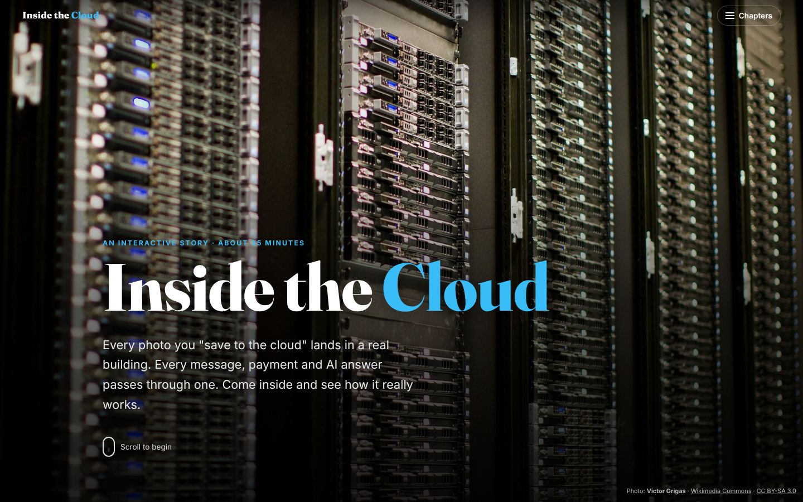

# Inside the Cloud: How a Data Center Really Works

An interactive, magazine-style story that explains data centers to curious beginners, in plain everyday language.
It covers servers, racks, storage, networking, power, cooling, **water use**, security, redundancy, the cloud, efficiency, and how data centers are built and run.
It also traces real activities, such as coding with Claude Code, running a Spark job on Databricks, streaming video, paying with UPI and sending a WhatsApp message, step by step through the building.

**Live site:** https://manish50.github.io/data_centers_cookbook/

## What's inside

12 chapters, each with a hook, short sections, real photos, "Did you know?" boxes, a recap and a 3-question quiz.

| # | Chapter | Try it |
|---|---|---|
| 01 | What is a data center? | "Your day online" app tapper |
| 02 | The guided tour: racks, storage, networking | Clickable floor plan, build-a-rack, spine-leaf diagram |
| 03 | Meet the servers | Server type explorer, clickable server photos, CPU-vs-GPU painting race, comparison table |
| 04 | The journey of a request | Animated request: normal website vs AI chatbot |
| 05 | Power | Power-failure simulator (UPS → batteries → generator) |
| 06 | Cooling (and water) | Hot/cold-aisle airflow animation, air vs liquid, water evaporated per rack |
| 07 | Security, fire and monitoring | Security layers, fire suppression sequence, control-room alarm game |
| 08 | Redundancy, uptime and tiers | Break units in N / N+1 / 2N, uptime "nines" slider |
| 09 | Virtualization and the cloud | Slice-a-server, "pizza as a service" |
| 10 | Real life, traced | Activity tracer: Claude Code, Spark on Databricks, streaming, UPI, WhatsApp, GitHub CI, video calls |
| 11 | Energy, water and the planet | PUE + WUE calculator |
| 12 | Planning, building and running | Pick-the-site game, build steps, a day in the life |

Key terms are underlined: tap or hover to see a plain-language explanation. Big numbers count up as you scroll.

## Run it locally

No server or install needed: open `index.html` in any modern browser. Everything (styles, scripts, diagrams) is inside `index.html`; photos are in `images/`.
Fonts load from Google Fonts when online; the page falls back to system fonts offline.

## Facts and sources

Numbers were checked in November 2026 against the IEA (*Energy and AI*, 2025), the Uptime Institute (2025 survey and outage analysis), Google, Microsoft, LBNL, NVIDIA and Supermicro specifications, NPCI, Netflix, Databricks, WhatsApp and others.
The full list is in the "Sources" section at the end of the page.

## Photo credits

All photos come from [Wikimedia Commons](https://commons.wikimedia.org/) under the free licences below. They were resized and compressed for the web, and some were cropped; adapted versions keep the same licence.
Diagrams and animations were drawn for this site. A machine-readable list is in [`images/credits.json`](images/credits.json).

| Used for | Photo | Author | Licence |
|---|---|---|---|
| Cover: Wikimedia Foundation server racks | [Wikimedia Foundation Servers-8055 35](https://commons.wikimedia.org/wiki/File:Wikimedia_Foundation_Servers-8055_35.jpg) | Victor Grigas | [CC BY-SA 3.0](https://creativecommons.org/licenses/by-sa/3.0) |
| Ch 1 opening: Google data center, The Dalles, Oregon | [Google Datacenter - The Dalles, Oregon (17832143871)](https://commons.wikimedia.org/wiki/File:Google_Datacenter_-_The_Dalles,_Oregon_(17832143871).jpg) | Tony Webster from Minneapolis, Minnesota, United States | [CC BY 2.0](https://creativecommons.org/licenses/by/2.0) |
| Ch 1: server hall at CERN | [CERN Server 03](https://commons.wikimedia.org/wiki/File:CERN_Server_03.jpg) | Florian Hirzinger - www.fh-ap.com | [CC BY-SA 3.0](https://creativecommons.org/licenses/by-sa/3.0) |
| Ch 1: CERN data centre building, Geneva | [CERN data centre](https://commons.wikimedia.org/wiki/File:CERN_data_centre.jpg) | Unnerving duck | [CC BY-SA 4.0](https://creativecommons.org/licenses/by-sa/4.0) |
| Ch 2 opening: data center aisle | [BalticServers data center](https://commons.wikimedia.org/wiki/File:BalticServers_data_center.jpg) | BalticServers.com | [CC BY-SA 3.0](https://creativecommons.org/licenses/by-sa/3.0) |
| Ch 2: Dell servers in a rack, with rack-unit numbers (Wikimedia) | [Wikimedia Foundation Servers-8055 43](https://commons.wikimedia.org/wiki/File:Wikimedia_Foundation_Servers-8055_43.jpg) | Victor Grigas | [CC BY-SA 3.0](https://creativecommons.org/licenses/by-sa/3.0) |
| Ch 2: storage system at Ifremer's Datarmor centre | [Le Centre Datarmor, les coulisses (Ifremer 00957-106840 - 54953)](https://commons.wikimedia.org/wiki/File:Le_Centre_Datarmor,_les_coulisses_(Ifremer_00957-106840_-_54953).jpg) | Gregory Rocher / Ifremer | [CC BY 4.0](https://creativecommons.org/licenses/by/4.0) |
| Ch 2: network switches and cables | [Network switches](https://commons.wikimedia.org/wiki/File:Network_switches.jpg) | ShakataGaNai | [CC BY-SA 3.0](https://creativecommons.org/licenses/by-sa/3.0) |
| Ch 3 opening: Wikimedia Foundation servers | [Wikimedia Foundation Servers-8055 13](https://commons.wikimedia.org/wiki/File:Wikimedia_Foundation_Servers-8055_13.jpg) | Victor Grigas | [CC BY-SA 3.0](https://creativecommons.org/licenses/by-sa/3.0) |
| Ch 3: rack servers | [Dell PowerEdge Servers](https://commons.wikimedia.org/wiki/File:Dell_PowerEdge_Servers.jpg) | Dsv | Public domain |
| Ch 3: HP BladeSystem c7000 blade chassis | [HP c7000-1](https://commons.wikimedia.org/wiki/File:HP_c7000-1.jpg) | Redline | [CC BY-SA 3.0](https://creativecommons.org/licenses/by-sa/3.0) |
| Ch 3: tower-style servers on shelves (BalticServers) | [BalticServers data center](https://commons.wikimedia.org/wiki/File:BalticServers_data_center.jpg) | BalticServers.com | [CC BY-SA 3.0](https://creativecommons.org/licenses/by-sa/3.0) |
| Ch 3: web and application servers (Wikimedia) | [Wikimedia Foundation Servers-8055 17](https://commons.wikimedia.org/wiki/File:Wikimedia_Foundation_Servers-8055_17.jpg) | Victor Grigas | [CC BY-SA 3.0](https://creativecommons.org/licenses/by-sa/3.0) |
| Ch 3: rack servers (Wikimedia) | [Wikimedia Foundation Servers-8055 08](https://commons.wikimedia.org/wiki/File:Wikimedia_Foundation_Servers-8055_08.jpg) | Victor Grigas | [CC BY-SA 3.0](https://creativecommons.org/licenses/by-sa/3.0) |
| Ch 3: storage server type | [Le Centre Datarmor, les coulisses (Ifremer 00957-106840 - 54953)](https://commons.wikimedia.org/wiki/File:Le_Centre_Datarmor,_les_coulisses_(Ifremer_00957-106840_-_54953).jpg) | Gregory Rocher / Ifremer | [CC BY 4.0](https://creativecommons.org/licenses/by/4.0) |
| Ch 3: AI server type | [Nvidia DGX-B200-HGX](https://commons.wikimedia.org/wiki/File:Nvidia_DGX-B200-HGX.jpg) | Pokiiri | [CC BY-SA 4.0](https://creativecommons.org/licenses/by-sa/4.0) |
| Ch 3: IBM System z10 mainframe | [IBM System z10](https://commons.wikimedia.org/wiki/File:IBM_System_z10.jpg) | Roberto Berlim from Brazil | [CC BY-SA 2.0](https://creativecommons.org/licenses/by-sa/2.0) |
| Ch 3: inside a 1U web server (Dell PowerEdge 850) | [Inside and Rear of Webserver](https://commons.wikimedia.org/wiki/File:Inside_and_Rear_of_Webserver.jpg) | Rodzilla at English Wikipedia | [CC BY 2.5](https://creativecommons.org/licenses/by/2.5) |
| Ch 3: NVIDIA HGX B200 GPU board | [Nvidia DGX-B200-HGX](https://commons.wikimedia.org/wiki/File:Nvidia_DGX-B200-HGX.jpg) | Pokiiri | [CC BY-SA 4.0](https://creativecommons.org/licenses/by-sa/4.0) |
| Ch 3: NVIDIA GB200 NVL72 rack | [Nvidia DGX GB200](https://commons.wikimedia.org/wiki/File:Nvidia_DGX_GB200.jpg) | Pokiiri | [CC BY-SA 4.0](https://creativecommons.org/licenses/by-sa/4.0) |
| Ch 4 opening: illuminated optical fibres | [Fiber optic illuminated](https://commons.wikimedia.org/wiki/File:Fiber_optic_illuminated.jpg) | Hustvedt | [CC BY-SA 3.0](https://creativecommons.org/licenses/by-sa/3.0) |
| Ch 4: network cables plugged into servers (Wikimedia) | [Wikimedia Foundation Servers-8055 24](https://commons.wikimedia.org/wiki/File:Wikimedia_Foundation_Servers-8055_24.jpg) | Victor Grigas | [CC BY-SA 3.0](https://creativecommons.org/licenses/by-sa/3.0) |
| Ch 5 opening: UPS cabinet row | [EPS 6000 Row B](https://commons.wikimedia.org/wiki/File:EPS_6000_Row_B.jpg) | Robert.Harker | [CC BY-SA 3.0](https://creativecommons.org/licenses/by-sa/3.0) |
| Ch 5: data center backup batteries | [Datacenter Backup Batteries](https://commons.wikimedia.org/wiki/File:Datacenter_Backup_Batteries.jpg) | Jelson25 | [CC BY 3.0](https://creativecommons.org/licenses/by/3.0) |
| Ch 5: diesel generator of a hospital data center | [Power generator of a hospital data center](https://commons.wikimedia.org/wiki/File:Power_generator_of_a_hospital_data_center.jpg) | Mikael Häggström | [CC0](http://creativecommons.org/publicdomain/zero/1.0/deed.en) |
| Ch 6 opening: CRAC cooling units | [CRAC Cabinets 2](https://commons.wikimedia.org/wiki/File:CRAC_Cabinets_2.jpg) | Robert.Harker | [CC BY-SA 3.0](https://creativecommons.org/licenses/by-sa/3.0) |
| Ch 6: aisle between server cabinets | [Cabinet Asile](https://commons.wikimedia.org/wiki/File:Cabinet_Asile.jpg) | Robert.Harker | [CC BY-SA 3.0](https://creativecommons.org/licenses/by-sa/3.0) |
| Ch 6: perforated raised-floor panel | [All-steel perforated ventilation raised floor panel 28 percent open area](https://commons.wikimedia.org/wiki/File:All-steel_perforated_ventilation_raised_floor_panel_28_percent_open_area.jpg) | LP Floor Group | [CC BY 4.0](https://creativecommons.org/licenses/by/4.0) |
| Ch 6: cooling tower on a data center, Mesa, Arizona | [Data center cooling tower](https://commons.wikimedia.org/wiki/File:Data_center_cooling_tower.jpg) | Rsparks3 | [CC0](http://creativecommons.org/publicdomain/zero/1.0/deed.en) |
| Ch 6: Asperitas immersion cooling system | [Asperitas AIC24 Immersion system](https://commons.wikimedia.org/wiki/File:Asperitas_AIC24_Immersion_system.jpg) | Rolf Brink | [CC BY-SA 4.0](https://creativecommons.org/licenses/by-sa/4.0) |
| Ch 7 opening: locked customer cage | [Cage Quelle EMC HostCo GmbH](https://commons.wikimedia.org/wiki/File:Cage_Quelle_EMC_HostCo_GmbH.jpg) | Virtuo Doc | [CC BY-SA 4.0](https://creativecommons.org/licenses/by-sa/4.0) |
| Ch 7: racks seen through protective enclosure (NOIRLab) | [Data Center Fish Eye View (noirlab-racks-155)](https://commons.wikimedia.org/wiki/File:Data_Center_Fish_Eye_View_(noirlab-racks-155).jpg) | International Gemini Observatory/NOIRLab/NSF/AURA/Manuel Paredes | [CC BY 4.0](https://creativecommons.org/licenses/by/4.0) |
| Ch 7: gas fire-suppression discharge in a server room | [COMPUTER ROOM DISCHARGE](https://commons.wikimedia.org/wiki/File:COMPUTER_ROOM_DISCHARGE.JPG) | Keith4048 | Public domain |
| Ch 8 opening: rows of Wikimedia Foundation servers | [Wikimedia Foundation Servers-8055 08](https://commons.wikimedia.org/wiki/File:Wikimedia_Foundation_Servers-8055_08.jpg) | Victor Grigas | [CC BY-SA 3.0](https://creativecommons.org/licenses/by-sa/3.0) |
| Ch 9 opening: IBM Blue Gene/P supercomputer, Argonne | [IBM Blue Gene P supercomputer](https://commons.wikimedia.org/wiki/File:IBM_Blue_Gene_P_supercomputer.jpg) | Argonne National Laboratory | [CC BY-SA 2.0](https://creativecommons.org/licenses/by-sa/2.0) |
| Ch 10 opening: compute trays of an NVIDIA GB200 rack | [Nvidia DGX GB200](https://commons.wikimedia.org/wiki/File:Nvidia_DGX_GB200.jpg) | Pokiiri | [CC BY-SA 4.0](https://creativecommons.org/licenses/by-sa/4.0) |
| Ch 11 opening: wind turbines and power lines, East Sussex | [Wind Turbines and Power Lines, East Sussex, England - April 2009](https://commons.wikimedia.org/wiki/File:Wind_Turbines_and_Power_Lines,_East_Sussex,_England_-_April_2009.jpg) | Diliff | [CC BY-SA 3.0](https://creativecommons.org/licenses/by-sa/3.0) |
| Ch 11: Google data center campus, Mayes County, Oklahoma | [Google Mayes County P0004974a](https://commons.wikimedia.org/wiki/File:Google_Mayes_County_P0004974a.jpg) | Xpda | [CC BY-SA 4.0](https://creativecommons.org/licenses/by-sa/4.0) |
| Ch 11: district heating pipes, Jyväskylä, Finland | [District heating pipes in Jyväskylä](https://commons.wikimedia.org/wiki/File:District_heating_pipes_in_Jyv%C3%A4skyl%C3%A4.jpg) | Antti Leppänen | [CC BY-SA 3.0](https://creativecommons.org/licenses/by-sa/3.0) |
| Ch 12 opening: generators at a nearly finished data center | [Una batteria di grossi generatori alimentati a gasolio in un Data Center in via di ultimazione](https://commons.wikimedia.org/wiki/File:Una_batteria_di_grossi_generatori_alimentati_a_gasolio_in_un_Data_Center_in_via_di_ultimazione.jpg) | Lapalmauz | [CC BY-SA 4.0](https://creativecommons.org/licenses/by-sa/4.0) |
| Ch 12: load bank testing a standby generator | [Air cooled load bank](https://commons.wikimedia.org/wiki/File:Air_cooled_load_bank.jpg) | Wtshymanski | [CC BY-SA 4.0](https://creativecommons.org/licenses/by-sa/4.0) |
| Finale: computing rack at Ifremer's Datarmor centre | [Le Centre Datarmor, les coulisses (Ifremer 00957-106840 - 54954)](https://commons.wikimedia.org/wiki/File:Le_Centre_Datarmor,_les_coulisses_(Ifremer_00957-106840_-_54954).jpg) | Gregory Rocher / Ifremer | [CC BY 4.0](https://creativecommons.org/licenses/by/4.0) |
| Ch 1: computer room, University of St. Gallen (historic) | [Blick in einen Raum des HSG-Rechenzentrums HSGH 022-001118](https://commons.wikimedia.org/wiki/File:Blick_in_einen_Raum_des_HSG-Rechenzentrums_HSGH_022-001118.jpg) | University of St. Gallen | [CC BY-SA 4.0](https://creativecommons.org/licenses/by-sa/4.0) |
| Ch 12: technician working on network equipment | [Network server and technician](https://commons.wikimedia.org/wiki/File:Network_server_and_technician.jpg) | Bill Branson (Photographer) | Public domain |
