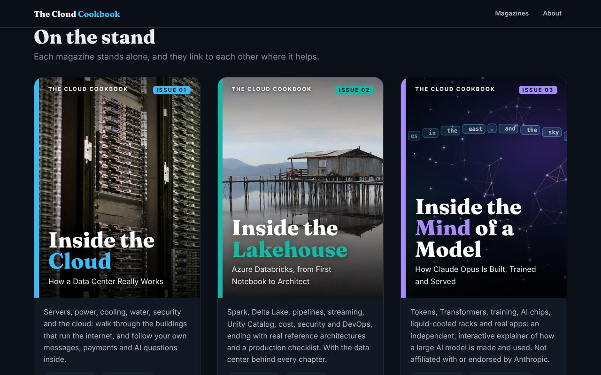
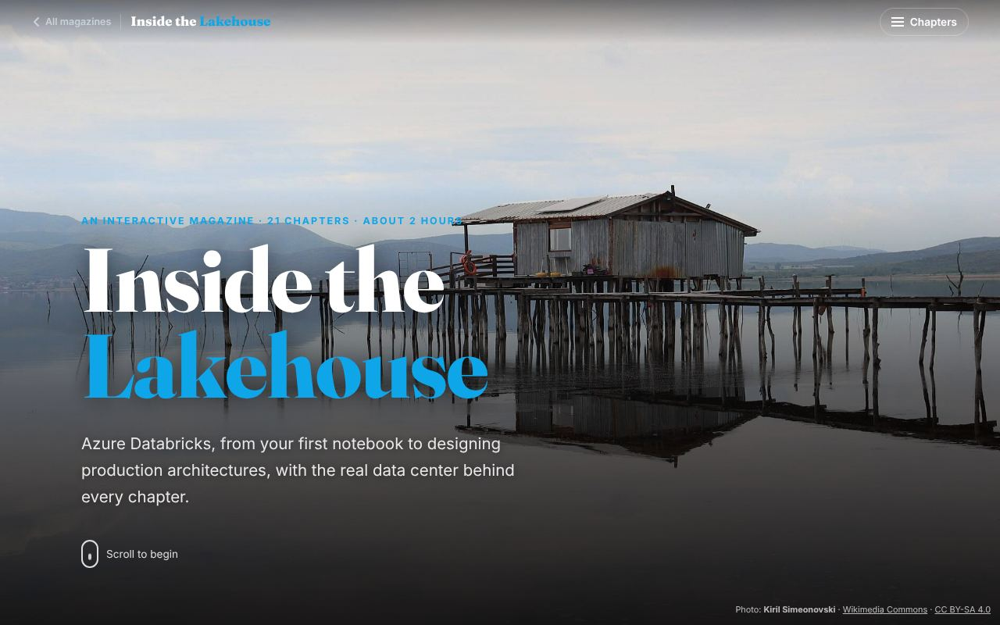

# The Cloud Cookbook

A free library of interactive, magazine-style explainers about how the cloud and AI really work, written in plain everyday language.
Each magazine has real photos, diagrams you can tap, small simulations and a quiz at the end of every chapter.

**Live library:** https://manish50.github.io/data_centers_cookbook/



## The magazines

| Issue | Magazine | Level | Chapters | Live link |
|---|---|---|---|---|
| 01 | **Inside the Cloud**: How a Data Center Really Works | Beginner | 12 · about 35 min | https://manish50.github.io/data_centers_cookbook/data-centers/ |
| 02 | **Inside the Lakehouse**: Azure Databricks, from First Notebook to Architect | Beginner to Advanced | 21 · about 2 h | https://manish50.github.io/data_centers_cookbook/azure-databricks/ |
| 03 | **Inside the Mind of a Model**: How Claude Opus Is Built, Trained and Served | Beginner to Advanced | 25 · about 2½ h | https://manish50.github.io/data_centers_cookbook/ai-model/ |

The home page remembers the last chapter you reached in each magazine and offers **Continue reading**.
That progress is stored only in your browser (`localStorage`), and every page still works when storage is blocked.

## How the site is organised

```
index.html                 library home page (magazine stand)
images/                    home-page images (README screenshot)
data-centers/index.html    Issue 01, photos in data-centers/images/
azure-databricks/index.html Issue 02, photos in azure-databricks/images/
ai-model/index.html        Issue 03, photos in ai-model/images/
.nojekyll                  serve files as-is on GitHub Pages
```

Each magazine is a single self-contained `index.html` (styles, scripts and diagrams inline) with its photos next to it.
Every path is relative, so the site works on GitHub Pages and when opened straight from disk.

### Adding a magazine

1. Create a folder, for example `my-topic/`, with its `index.html` and `images/` (include `images/cover-sm.jpg` and `images/cover-lg.jpg`).
2. Add an "All magazines" link to `../` in its top bar. To support Continue reading, save `localStorage['cookbook:my-topic'] = {id, num, title, at}` inside a try/catch.
3. Add one entry to the `MAGAZINES` list at the top of the script in the root `index.html`.

## Run it locally

No server or install needed: open `index.html` in any modern browser.
Fonts (Fraunces and Inter) load from Google Fonts when online, and the pages fall back to system fonts offline.

---

## Issue 01: Inside the Cloud


An interactive story about data centers for curious beginners. It covers servers, racks, storage, networking, power, cooling, **water use**, security, redundancy, the cloud, efficiency, and how data centers are built and run.
It also traces real activities step by step through the building, such as coding with Claude Code, running a Spark job on Databricks, streaming video, paying with UPI and sending a WhatsApp message.

| # | Chapter | Try it |
|---|---|---|
| 01 | What is a data center? | "Your day online" app tapper |
| 02 | The guided tour: racks, storage, networking | Clickable floor plan, build-a-rack, spine-leaf diagram |
| 03 | Meet the servers | Server type explorer, clickable server photos, CPU-vs-GPU painting race |
| 04 | The journey of a request | Animated request: normal website vs AI chatbot |
| 05 | Power | Power-failure simulator (UPS → batteries → generator) |
| 06 | Cooling (and water) | Hot/cold-aisle airflow, air vs liquid, water evaporated per rack |
| 07 | Security, fire and monitoring | Security layers, fire suppression, control-room alarm game |
| 08 | Redundancy, uptime and tiers | Break units in N / N+1 / 2N, uptime "nines" slider |
| 09 | Virtualization and the cloud | Slice-a-server, "pizza as a service" |
| 10 | Real life, traced | Activity tracer: Claude Code, Spark on Databricks, streaming, UPI, WhatsApp, CI, video calls |
| 11 | Energy, water and the planet | PUE + WUE calculator |
| 12 | Planning, building and running | Pick-the-site game, build steps, a day in the life |

**Facts and sources:** numbers were checked in November 2026 against the IEA (*Energy and AI*, 2025), the Uptime Institute, Google, Microsoft, LBNL, NVIDIA and Supermicro specifications, NPCI, Netflix, Databricks, WhatsApp and others.
The full list with links is in the "Sources" section at the end of the magazine.

### Photo credits: Inside the Cloud

All photos come from [Wikimedia Commons](https://commons.wikimedia.org/) under the free licences below. They were resized and compressed for the web, and some were cropped; adapted versions keep the same licence.
Diagrams and animations were drawn for this site. A machine-readable list is in [`data-centers/images/credits.json`](data-centers/images/credits.json).

| Used for | Photo | Author | Licence |
|---|---|---|---|
| Cover: Wikimedia Foundation server racks | [Wikimedia Foundation Servers-8055 35](https://commons.wikimedia.org/wiki/File:Wikimedia_Foundation_Servers-8055_35.jpg) | Victor Grigas | [CC BY-SA 3.0](https://creativecommons.org/licenses/by-sa/3.0) |
| Ch 1 opening: Google data center, The Dalles, Oregon | [Google Datacenter - The Dalles, Oregon (17832143871)](https://commons.wikimedia.org/wiki/File:Google_Datacenter_-_The_Dalles,_Oregon_(17832143871).jpg) | Tony Webster from Minneapolis, Minnesota, United States | [CC BY 2.0](https://creativecommons.org/licenses/by/2.0) |
| Ch 1: server hall at CERN | [CERN Server 03](https://commons.wikimedia.org/wiki/File:CERN_Server_03.jpg) | Florian Hirzinger - www.fh-ap.com | [CC BY-SA 3.0](https://creativecommons.org/licenses/by-sa/3.0) |
| Ch 1: CERN data centre building, Geneva | [CERN data centre](https://commons.wikimedia.org/wiki/File:CERN_data_centre.jpg) | Unnerving duck | [CC BY-SA 4.0](https://creativecommons.org/licenses/by-sa/4.0) |
| Ch 2 opening: data center aisle | [BalticServers data center](https://commons.wikimedia.org/wiki/File:BalticServers_data_center.jpg) | BalticServers.com | [CC BY-SA 3.0](https://creativecommons.org/licenses/by-sa/3.0) |
| Ch 2: Dell servers in a rack, with rack-unit numbers (Wikimedia) | [Wikimedia Foundation Servers-8055 43](https://commons.wikimedia.org/wiki/File:Wikimedia_Foundation_Servers-8055_43.jpg) | Victor Grigas | [CC BY-SA 3.0](https://creativecommons.org/licenses/by-sa/3.0) |
| Ch 2: storage system at Ifremer's Datarmor centre | [Le Centre Datarmor, les coulisses (Ifremer 00957-106840 - 54953)](https://commons.wikimedia.org/wiki/File:Le_Centre_Datarmor,_les_coulisses_(Ifremer_00957-106840_-_54953).jpg) | Gregory Rocher / Ifremer | [CC BY 4.0](https://creativecommons.org/licenses/by/4.0) |
| Ch 2: network switches and cables | [Network switches](https://commons.wikimedia.org/wiki/File:Network_switches.jpg) | ShakataGaNai | [CC BY-SA 3.0](https://creativecommons.org/licenses/by-sa/3.0) |
| Ch 3 opening: Wikimedia Foundation servers | [Wikimedia Foundation Servers-8055 13](https://commons.wikimedia.org/wiki/File:Wikimedia_Foundation_Servers-8055_13.jpg) | Victor Grigas | [CC BY-SA 3.0](https://creativecommons.org/licenses/by-sa/3.0) |
| Ch 3: rack servers | [Dell PowerEdge Servers](https://commons.wikimedia.org/wiki/File:Dell_PowerEdge_Servers.jpg) | Dsv | Public domain |
| Ch 3: HP BladeSystem c7000 blade chassis | [HP c7000-1](https://commons.wikimedia.org/wiki/File:HP_c7000-1.jpg) | Redline | [CC BY-SA 3.0](https://creativecommons.org/licenses/by-sa/3.0) |
| Ch 3: tower-style servers on shelves (BalticServers) | [BalticServers data center](https://commons.wikimedia.org/wiki/File:BalticServers_data_center.jpg) | BalticServers.com | [CC BY-SA 3.0](https://creativecommons.org/licenses/by-sa/3.0) |
| Ch 3: web and application servers (Wikimedia) | [Wikimedia Foundation Servers-8055 17](https://commons.wikimedia.org/wiki/File:Wikimedia_Foundation_Servers-8055_17.jpg) | Victor Grigas | [CC BY-SA 3.0](https://creativecommons.org/licenses/by-sa/3.0) |
| Ch 3: rack servers (Wikimedia) | [Wikimedia Foundation Servers-8055 08](https://commons.wikimedia.org/wiki/File:Wikimedia_Foundation_Servers-8055_08.jpg) | Victor Grigas | [CC BY-SA 3.0](https://creativecommons.org/licenses/by-sa/3.0) |
| Ch 3: storage server type | [Le Centre Datarmor, les coulisses (Ifremer 00957-106840 - 54953)](https://commons.wikimedia.org/wiki/File:Le_Centre_Datarmor,_les_coulisses_(Ifremer_00957-106840_-_54953).jpg) | Gregory Rocher / Ifremer | [CC BY 4.0](https://creativecommons.org/licenses/by/4.0) |
| Ch 3: AI server type | [Nvidia DGX-B200-HGX](https://commons.wikimedia.org/wiki/File:Nvidia_DGX-B200-HGX.jpg) | Pokiiri | [CC BY-SA 4.0](https://creativecommons.org/licenses/by-sa/4.0) |
| Ch 3: IBM System z10 mainframe | [IBM System z10](https://commons.wikimedia.org/wiki/File:IBM_System_z10.jpg) | Roberto Berlim from Brazil | [CC BY-SA 2.0](https://creativecommons.org/licenses/by-sa/2.0) |
| Ch 3: inside a 1U web server (Dell PowerEdge 850) | [Inside and Rear of Webserver](https://commons.wikimedia.org/wiki/File:Inside_and_Rear_of_Webserver.jpg) | Rodzilla at English Wikipedia | [CC BY 2.5](https://creativecommons.org/licenses/by/2.5) |
| Ch 3: NVIDIA HGX B200 GPU board | [Nvidia DGX-B200-HGX](https://commons.wikimedia.org/wiki/File:Nvidia_DGX-B200-HGX.jpg) | Pokiiri | [CC BY-SA 4.0](https://creativecommons.org/licenses/by-sa/4.0) |
| Ch 3: NVIDIA GB200 NVL72 rack | [Nvidia DGX GB200](https://commons.wikimedia.org/wiki/File:Nvidia_DGX_GB200.jpg) | Pokiiri | [CC BY-SA 4.0](https://creativecommons.org/licenses/by-sa/4.0) |
| Ch 4 opening: illuminated optical fibres | [Fiber optic illuminated](https://commons.wikimedia.org/wiki/File:Fiber_optic_illuminated.jpg) | Hustvedt | [CC BY-SA 3.0](https://creativecommons.org/licenses/by-sa/3.0) |
| Ch 4: network cables plugged into servers (Wikimedia) | [Wikimedia Foundation Servers-8055 24](https://commons.wikimedia.org/wiki/File:Wikimedia_Foundation_Servers-8055_24.jpg) | Victor Grigas | [CC BY-SA 3.0](https://creativecommons.org/licenses/by-sa/3.0) |
| Ch 5 opening: UPS cabinet row | [EPS 6000 Row B](https://commons.wikimedia.org/wiki/File:EPS_6000_Row_B.jpg) | Robert.Harker | [CC BY-SA 3.0](https://creativecommons.org/licenses/by-sa/3.0) |
| Ch 5: data center backup batteries | [Datacenter Backup Batteries](https://commons.wikimedia.org/wiki/File:Datacenter_Backup_Batteries.jpg) | Jelson25 | [CC BY 3.0](https://creativecommons.org/licenses/by/3.0) |
| Ch 5: diesel generator of a hospital data center | [Power generator of a hospital data center](https://commons.wikimedia.org/wiki/File:Power_generator_of_a_hospital_data_center.jpg) | Mikael Häggström | [CC0](http://creativecommons.org/publicdomain/zero/1.0/deed.en) |
| Ch 6 opening: CRAC cooling units | [CRAC Cabinets 2](https://commons.wikimedia.org/wiki/File:CRAC_Cabinets_2.jpg) | Robert.Harker | [CC BY-SA 3.0](https://creativecommons.org/licenses/by-sa/3.0) |
| Ch 6: aisle between server cabinets | [Cabinet Asile](https://commons.wikimedia.org/wiki/File:Cabinet_Asile.jpg) | Robert.Harker | [CC BY-SA 3.0](https://creativecommons.org/licenses/by-sa/3.0) |
| Ch 6: perforated raised-floor panel | [All-steel perforated ventilation raised floor panel 28 percent open area](https://commons.wikimedia.org/wiki/File:All-steel_perforated_ventilation_raised_floor_panel_28_percent_open_area.jpg) | LP Floor Group | [CC BY 4.0](https://creativecommons.org/licenses/by/4.0) |
| Ch 6: cooling tower on a data center, Mesa, Arizona | [Data center cooling tower](https://commons.wikimedia.org/wiki/File:Data_center_cooling_tower.jpg) | Rsparks3 | [CC0](http://creativecommons.org/publicdomain/zero/1.0/deed.en) |
| Ch 6: Asperitas immersion cooling system | [Asperitas AIC24 Immersion system](https://commons.wikimedia.org/wiki/File:Asperitas_AIC24_Immersion_system.jpg) | Rolf Brink | [CC BY-SA 4.0](https://creativecommons.org/licenses/by-sa/4.0) |
| Ch 7 opening: locked customer cage | [Cage Quelle EMC HostCo GmbH](https://commons.wikimedia.org/wiki/File:Cage_Quelle_EMC_HostCo_GmbH.jpg) | Virtuo Doc | [CC BY-SA 4.0](https://creativecommons.org/licenses/by-sa/4.0) |
| Ch 7: racks seen through protective enclosure (NOIRLab) | [Data Center Fish Eye View (noirlab-racks-155)](https://commons.wikimedia.org/wiki/File:Data_Center_Fish_Eye_View_(noirlab-racks-155).jpg) | International Gemini Observatory/NOIRLab/NSF/AURA/Manuel Paredes | [CC BY 4.0](https://creativecommons.org/licenses/by/4.0) |
| Ch 7: gas fire-suppression discharge in a server room | [COMPUTER ROOM DISCHARGE](https://commons.wikimedia.org/wiki/File:COMPUTER_ROOM_DISCHARGE.JPG) | Keith4048 | Public domain |
| Ch 8 opening: rows of Wikimedia Foundation servers | [Wikimedia Foundation Servers-8055 08](https://commons.wikimedia.org/wiki/File:Wikimedia_Foundation_Servers-8055_08.jpg) | Victor Grigas | [CC BY-SA 3.0](https://creativecommons.org/licenses/by-sa/3.0) |
| Ch 9 opening: IBM Blue Gene/P supercomputer, Argonne | [IBM Blue Gene P supercomputer](https://commons.wikimedia.org/wiki/File:IBM_Blue_Gene_P_supercomputer.jpg) | Argonne National Laboratory | [CC BY-SA 2.0](https://creativecommons.org/licenses/by-sa/2.0) |
| Ch 10 opening: compute trays of an NVIDIA GB200 rack | [Nvidia DGX GB200](https://commons.wikimedia.org/wiki/File:Nvidia_DGX_GB200.jpg) | Pokiiri | [CC BY-SA 4.0](https://creativecommons.org/licenses/by-sa/4.0) |
| Ch 11 opening: wind turbines and power lines, East Sussex | [Wind Turbines and Power Lines, East Sussex, England - April 2009](https://commons.wikimedia.org/wiki/File:Wind_Turbines_and_Power_Lines,_East_Sussex,_England_-_April_2009.jpg) | Diliff | [CC BY-SA 3.0](https://creativecommons.org/licenses/by-sa/3.0) |
| Ch 11: Google data center campus, Mayes County, Oklahoma | [Google Mayes County P0004974a](https://commons.wikimedia.org/wiki/File:Google_Mayes_County_P0004974a.jpg) | Xpda | [CC BY-SA 4.0](https://creativecommons.org/licenses/by-sa/4.0) |
| Ch 11: district heating pipes, Jyväskylä, Finland | [District heating pipes in Jyväskylä](https://commons.wikimedia.org/wiki/File:District_heating_pipes_in_Jyv%C3%A4skyl%C3%A4.jpg) | Antti Leppänen | [CC BY-SA 3.0](https://creativecommons.org/licenses/by-sa/3.0) |
| Ch 12 opening: generators at a nearly finished data center | [Una batteria di grossi generatori alimentati a gasolio in un Data Center in via di ultimazione](https://commons.wikimedia.org/wiki/File:Una_batteria_di_grossi_generatori_alimentati_a_gasolio_in_un_Data_Center_in_via_di_ultimazione.jpg) | Lapalmauz | [CC BY-SA 4.0](https://creativecommons.org/licenses/by-sa/4.0) |
| Ch 12: load bank testing a standby generator | [Air cooled load bank](https://commons.wikimedia.org/wiki/File:Air_cooled_load_bank.jpg) | Wtshymanski | [CC BY-SA 4.0](https://creativecommons.org/licenses/by-sa/4.0) |
| Finale: computing rack at Ifremer's Datarmor centre | [Le Centre Datarmor, les coulisses (Ifremer 00957-106840 - 54954)](https://commons.wikimedia.org/wiki/File:Le_Centre_Datarmor,_les_coulisses_(Ifremer_00957-106840_-_54954).jpg) | Gregory Rocher / Ifremer | [CC BY 4.0](https://creativecommons.org/licenses/by/4.0) |
| Ch 1: computer room, University of St. Gallen (historic) | [Blick in einen Raum des HSG-Rechenzentrums HSGH 022-001118](https://commons.wikimedia.org/wiki/File:Blick_in_einen_Raum_des_HSG-Rechenzentrums_HSGH_022-001118.jpg) | University of St. Gallen | [CC BY-SA 4.0](https://creativecommons.org/licenses/by-sa/4.0) |
| Ch 12: technician working on network equipment | [Network server and technician](https://commons.wikimedia.org/wiki/File:Network_server_and_technician.jpg) | Bill Branson (Photographer) | Public domain |

---

## Issue 02: Inside the Lakehouse



A guide to Azure Databricks for data engineers and architects, from "What is Databricks?" to a production-ready design.
Chapters are marked **Beginner**, **Intermediate** or **Advanced**, and a learning path at the start shows three tracks.
Every chapter has an **Inside the data center** panel: a short summary with a "See inside" button that opens up the physical side. It covers where the work runs, which Azure VM families it uses, how the data travels, power and heat, scale, what happens when something breaks, and how it would feel to stand there. It also has a "Go deeper" link into the matching chapter of Issue 01.

| # | Chapter | Level | Try it |
|---|---|---|---|
| 01 | What is Databricks? | Beginner | Persona picker |
| 02 | Lake, warehouse, lakehouse | Beginner | "Where would you keep it?" sorter |
| 03 | The architecture | Beginner | Architecture explorer |
| 04 | Its neighbours in Azure | Beginner | Azure neighbourhood map |
| 05 | Compute: choosing your engine | Beginner | "Which compute?" chooser |
| 06 | Spark basics | Beginner | Spark job animation with executor slider |
| 07 | Delta Lake | Intermediate | Time-travel slider + VACUUM |
| 08 | Medallion architecture | Intermediate | Bronze → silver → gold animation |
| 09 | Getting data in | Intermediate | Auto Loader demo + ingestion picker |
| 10 | Building pipelines | Intermediate | Batch vs streaming toggle, expectations demo |
| 11 | Structured Streaming | Intermediate | Watermark / late-data slider |
| 12 | Orchestration | Intermediate | Job DAG with failure, retry and repair |
| 13 | Unity Catalog | Intermediate | Catalog explorer: who can see what |
| 14 | Databricks SQL and dashboards | Intermediate | Rush-hour SQL warehouse demo |
| 15 | Performance tuning | Advanced | Data skew demo (AQE, salting) |
| 16 | Cost control | Advanced | Cluster cost estimator (example prices) |
| 17 | Security and networking | Advanced | Network lock-down in 4 steps |
| 18 | DevOps | Advanced | dev → test → prod promotion |
| 19 | ML and AI | Advanced | MLflow lifecycle stepper |
| 20 | Reference architectures | Advanced | Architecture switcher |
| 21 | Mistakes and the architect checklist | Advanced | Production-readiness checklist |

Product names follow the current Microsoft Learn and Databricks documentation (checked November 2026):
- Lakeflow Spark Declarative Pipelines (formerly Delta Live Tables)
- Lakeflow Jobs (formerly Workflows)
- Declarative Automation Bundles (formerly Databricks Asset Bundles)
- OpenSharing (formerly Delta Sharing)
- Git folders
- Standard / Dedicated access modes

Prices in the cost estimator are **examples** from the Azure Databricks pricing page (Premium, pay-as-you-go, US East). Prices change, so it is not a quote.

This is an independent educational guide. It is not affiliated with or endorsed by Microsoft or Databricks, and it uses no official logos or diagrams. All diagrams were drawn for this site.

### Sources: Inside the Lakehouse

- [What is Azure Databricks?](https://learn.microsoft.com/en-us/azure/databricks/introduction/)
- [High-level architecture](https://learn.microsoft.com/en-us/azure/databricks/getting-started/high-level-architecture)
- [End of life for Standard tier workspaces](https://learn.microsoft.com/en-us/azure/databricks/admin/account-settings/standard-tier)
- [Compute](https://learn.microsoft.com/en-us/azure/databricks/compute/)
- [Compute configuration](https://learn.microsoft.com/en-us/azure/databricks/compute/configure)
- [Photon](https://learn.microsoft.com/en-us/azure/databricks/compute/photon)
- [SQL warehouse types](https://learn.microsoft.com/en-us/azure/databricks/compute/sql-warehouse/warehouse-types)
- [SQL warehouse sizing and scaling](https://learn.microsoft.com/en-us/azure/databricks/compute/sql-warehouse/warehouse-behavior)
- [Table history and time travel](https://learn.microsoft.com/en-us/azure/databricks/delta/history)
- [VACUUM](https://learn.microsoft.com/en-us/azure/databricks/delta/vacuum)
- [MERGE](https://learn.microsoft.com/en-us/azure/databricks/delta/merge)
- [Liquid clustering](https://learn.microsoft.com/en-us/azure/databricks/delta/clustering)
- [Predictive optimization](https://learn.microsoft.com/en-us/azure/databricks/optimizations/predictive-optimization)
- [Medallion architecture](https://learn.microsoft.com/en-us/azure/databricks/lakehouse/medallion)
- [Auto Loader](https://learn.microsoft.com/en-us/azure/databricks/ingestion/cloud-object-storage/auto-loader/)
- [COPY INTO](https://learn.microsoft.com/en-us/azure/databricks/ingestion/copy-into/)
- [Lakeflow Connect](https://learn.microsoft.com/en-us/azure/databricks/ingestion/lakeflow-connect/)
- [Lakeflow Spark Declarative Pipelines](https://learn.microsoft.com/en-us/azure/databricks/ldp/)
- [What happened to DLT?](https://learn.microsoft.com/en-us/azure/databricks/ldp/concepts/where-is-dlt)
- [Expectations](https://learn.microsoft.com/en-us/azure/databricks/ldp/expectations)
- [Triggers](https://learn.microsoft.com/en-us/azure/databricks/structured-streaming/triggers)
- [Watermarks](https://learn.microsoft.com/en-us/azure/databricks/structured-streaming/watermarks)
- [Lakeflow Jobs](https://learn.microsoft.com/en-us/azure/databricks/jobs/)
- [Unity Catalog](https://learn.microsoft.com/en-us/azure/databricks/data-governance/unity-catalog/)
- [OpenSharing](https://learn.microsoft.com/en-us/azure/databricks/delta-sharing/)
- [Secure cluster connectivity](https://learn.microsoft.com/en-us/azure/databricks/security/network/classic/secure-cluster-connectivity)
- [VNet injection](https://learn.microsoft.com/en-us/azure/databricks/security/network/classic/vnet-inject)
- [Private Link](https://learn.microsoft.com/en-us/azure/databricks/security/network/classic/private-link)
- [Secrets](https://learn.microsoft.com/en-us/azure/databricks/security/secrets/)
- [Adaptive Query Execution](https://learn.microsoft.com/en-us/azure/databricks/optimizations/aqe)
- [Disk cache](https://learn.microsoft.com/en-us/azure/databricks/optimizations/disk-cache)
- [Git folders](https://learn.microsoft.com/en-us/azure/databricks/repos/)
- [Declarative Automation Bundles](https://learn.microsoft.com/en-us/azure/databricks/dev-tools/bundles/)
- [Bundles release notes (rename, March 2026)](https://docs.databricks.com/aws/en/release-notes/dev-tools/bundles)
- [MLflow](https://learn.microsoft.com/en-us/azure/databricks/mlflow/)
- [Model Serving](https://learn.microsoft.com/en-us/azure/databricks/machine-learning/model-serving/)
- [Agent Bricks](https://learn.microsoft.com/en-us/azure/databricks/generative-ai/agent-bricks/)
- [AI/BI dashboards](https://learn.microsoft.com/en-us/azure/databricks/dashboards/)
- [Genie](https://learn.microsoft.com/en-us/azure/databricks/genie/)
- [Power BI](https://learn.microsoft.com/en-us/azure/databricks/partners/bi/power-bi)
- [VM sizes](https://learn.microsoft.com/en-us/azure/virtual-machines/sizes/overview)
- [Ddsv5](https://learn.microsoft.com/en-us/azure/virtual-machines/sizes/general-purpose/ddsv5-series)
- [Edsv5](https://learn.microsoft.com/en-us/azure/virtual-machines/sizes/memory-optimized/edsv5-series)
- [Fsv2](https://learn.microsoft.com/en-us/azure/virtual-machines/sizes/compute-optimized/fsv2-series)
- [Lsv3](https://learn.microsoft.com/en-us/azure/virtual-machines/sizes/storage-optimized/lsv3-series)
- [ND H100 v5](https://learn.microsoft.com/en-us/azure/virtual-machines/sizes/gpu-accelerated/ndh100v5-series)
- [Storage redundancy](https://learn.microsoft.com/en-us/azure/storage/common/storage-redundancy)
- [Availability zones](https://learn.microsoft.com/en-us/azure/reliability/availability-zones-overview)
- [Azure Spot VMs](https://learn.microsoft.com/en-us/azure/virtual-machines/spot-vms)
- [Azure Databricks pricing](https://azure.microsoft.com/en-us/pricing/details/databricks/)
- [Databricks Runtime release notes](https://docs.databricks.com/aws/en/release-notes/runtime/)
- [Lakeflow Jobs (formerly Workflows)](https://www.databricks.com/blog/whats-new-lakeflow-jobs-provides-more-efficient-data-orchestration)

### Photo credits: Inside the Lakehouse

All photos come from [Wikimedia Commons](https://commons.wikimedia.org/) under the free licences below (several are shared with Issue 01). They were resized and compressed for the web, and some were cropped; adapted versions keep the same licence.
A machine-readable list is in [`azure-databricks/images/credits.json`](azure-databricks/images/credits.json).

| Used for | Photo | Author | Licence |
|---|---|---|---|
| Cover: a stilt house in Lake Dojran | [Наколно живеалиште во Дојранско Езеро](https://commons.wikimedia.org/wiki/File:%D0%9D%D0%B0%D0%BA%D0%BE%D0%BB%D0%BD%D0%BE_%D0%B6%D0%B8%D0%B2%D0%B5%D0%B0%D0%BB%D0%B8%D1%88%D1%82%D0%B5_%D0%B2%D0%BE_%D0%94%D0%BE%D1%98%D1%80%D0%B0%D0%BD%D1%81%D0%BA%D0%BE_%D0%95%D0%B7%D0%B5%D1%80%D0%BE.jpg) | Kiril Simeonovski | [CC BY-SA 4.0](https://creativecommons.org/licenses/by-sa/4.0) |
| Ch 1 opening: server hall at CERN | [CERN Server 03](https://commons.wikimedia.org/wiki/File:CERN_Server_03.jpg) | Florian Hirzinger - www.fh-ap.com | [CC BY-SA 3.0](https://creativecommons.org/licenses/by-sa/3.0) |
| Ch 1 inside panel: rows of Wikimedia Foundation servers | [Wikimedia Foundation Servers-8055 08](https://commons.wikimedia.org/wiki/File:Wikimedia_Foundation_Servers-8055_08.jpg) | Victor Grigas | [CC BY-SA 3.0](https://creativecommons.org/licenses/by-sa/3.0) |
| Ch 2 opening: lake with a house on its shore | [Lake at summer scenic white house on shore in background](https://commons.wikimedia.org/wiki/File:Lake_at_summer_scenic_white_house_on_shore_in_background.jpg) | U.S. Fish and Wildlife Service | Public domain |
| Ch 2 inside panel: storage system at Ifremer's Datarmor centre | [Le Centre Datarmor, les coulisses (Ifremer 00957-106840 - 54953)](https://commons.wikimedia.org/wiki/File:Le_Centre_Datarmor,_les_coulisses_(Ifremer_00957-106840_-_54953).jpg) | Gregory Rocher / Ifremer | [CC BY 4.0](https://creativecommons.org/licenses/by/4.0) |
| Ch 3 opening: Google data center campus, Mayes County, Oklahoma | [Google Mayes County P0004974a](https://commons.wikimedia.org/wiki/File:Google_Mayes_County_P0004974a.jpg) | Xpda | [CC BY-SA 4.0](https://creativecommons.org/licenses/by-sa/4.0) |
| Ch 4 opening: illuminated optical fibres | [Fiber optic illuminated](https://commons.wikimedia.org/wiki/File:Fiber_optic_illuminated.jpg) | Hustvedt | [CC BY-SA 3.0](https://creativecommons.org/licenses/by-sa/3.0) |
| Ch 5 opening: Dell servers in a rack (Wikimedia) | [Wikimedia Foundation Servers-8055 43](https://commons.wikimedia.org/wiki/File:Wikimedia_Foundation_Servers-8055_43.jpg) | Victor Grigas | [CC BY-SA 3.0](https://creativecommons.org/licenses/by-sa/3.0) |
| Ch 6 opening: Wikimedia Foundation servers | [Wikimedia Foundation Servers-8055 13](https://commons.wikimedia.org/wiki/File:Wikimedia_Foundation_Servers-8055_13.jpg) | Victor Grigas | [CC BY-SA 3.0](https://creativecommons.org/licenses/by-sa/3.0) |
| Ch 7 opening: library bookstacks, 1904 | [Bookstacks1904 - DPLA - b3cd3f1ec1091fd385286151c2e6e417](https://commons.wikimedia.org/wiki/File:Bookstacks1904_-_DPLA_-_b3cd3f1ec1091fd385286151c2e6e417.jpg) | Brackett, J. Raymond | Public domain |
| Ch 8 opening: 1996 Summer Olympics medals | [1996 Summer Olympics medals, Atlanta History Center](https://commons.wikimedia.org/wiki/File:1996_Summer_Olympics_medals,_Atlanta_History_Center.jpg) | JJonahJackalope | [CC BY-SA 4.0](https://creativecommons.org/licenses/by-sa/4.0) |
| Ch 9 opening: Lemon Reservoir, Colorado | [Lemon Reservoir, Colorado](https://commons.wikimedia.org/wiki/File:Lemon_Reservoir,_Colorado.jpg) | Radomianin | [CC BY-SA 4.0](https://creativecommons.org/licenses/by-sa/4.0) |
| Ch 10 opening: interior pipelines, Gates Rubber | [Gates Rubber, interior pipelines](https://commons.wikimedia.org/wiki/File:Gates_Rubber,_interior_pipelines.jpg) | Eric Jusino from Denver, CO, USA | [CC BY 2.0](https://creativecommons.org/licenses/by/2.0) |
| Ch 11 opening: fast mountain river | [Fast mountain river flowing through the conifer forest](https://commons.wikimedia.org/wiki/File:Fast_mountain_river_flowing_through_the_conifer_forest.jpg) | Smith Michael L, U.S. Fish and Wildlife Service | Public domain |
| Ch 12 opening: CSX train switching, Framingham North Yard | [CSX train switching at Framingham North Yard June 2026](https://commons.wikimedia.org/wiki/File:CSX_train_switching_at_Framingham_North_Yard_June_2026.jpg) | 4300streetcar | [CC BY 4.0](https://creativecommons.org/licenses/by/4.0) |
| Ch 13 opening: card catalog drawer, Library of Congress | [Copyright Card Catalog Drawer](https://commons.wikimedia.org/wiki/File:Copyright_Card_Catalog_Drawer.jpg) | Michael Holley Swtpc6800 | Public domain |
| Ch 14 opening: KC-135 Stratotanker cockpit | [KC-135 Stratotanker Cockpit](https://commons.wikimedia.org/wiki/File:KC-135_Stratotanker_Cockpit.JPG) | Unknown | Public domain |
| Ch 15 opening: Formula One wheel gun | [Formula One Wheel Gun](https://commons.wikimedia.org/wiki/File:Formula_One_Wheel_Gun.jpg) | Rich Jones from United Kingdom | [CC BY 2.0](https://creativecommons.org/licenses/by/2.0) |
| Ch 16 opening: a pile of coins | [A pile of Ukrainian currency coins](https://commons.wikimedia.org/wiki/File:A_pile_of_Ukrainian_currency_coins.jpg) | Роман Рябенко | [CC0](http://creativecommons.org/publicdomain/zero/1.0/deed.en) |
| Ch 17 opening: locked customer cage in a data center | [Cage Quelle EMC HostCo GmbH](https://commons.wikimedia.org/wiki/File:Cage_Quelle_EMC_HostCo_GmbH.jpg) | Virtuo Doc | [CC BY-SA 4.0](https://creativecommons.org/licenses/by-sa/4.0) |
| Ch 18 opening: container cranes, Fremantle Harbour | [Container cranes in Fremantle Harbour, July 2023 01](https://commons.wikimedia.org/wiki/File:Container_cranes_in_Fremantle_Harbour,_July_2023_01.jpg) | Calistemon | [CC BY-SA 4.0](https://creativecommons.org/licenses/by-sa/4.0) |
| Ch 19 opening: NVIDIA HGX B200 GPU board | [Nvidia DGX-B200-HGX](https://commons.wikimedia.org/wiki/File:Nvidia_DGX-B200-HGX.jpg) | Pokiiri | [CC BY-SA 4.0](https://creativecommons.org/licenses/by-sa/4.0) |
| Ch 20 opening: blueprint of an elevation | [Blueprint of elevation by Alice Trythall Washburn](https://commons.wikimedia.org/wiki/File:Blueprint_of_elevation_by_Alice_Trythall_Washburn.jpg) | Alice Trythall Washburn | Public domain |
| Ch 21 opening: pilots in a C-130J cockpit | [120316-F-LR266-986 C-130J Hercules Cockpit Ramstein Air Base 2012](https://commons.wikimedia.org/wiki/File:120316-F-LR266-986_C-130J_Hercules_Cockpit_Ramstein_Air_Base_2012.jpg) | U.S. Air Force photo/Staff Sgt. Chris Willis | Public domain |
| Finale: stilt house in Lake Dojran | [Наколно живеалиште во Дојранско Езеро](https://commons.wikimedia.org/wiki/File:%D0%9D%D0%B0%D0%BA%D0%BE%D0%BB%D0%BD%D0%BE_%D0%B6%D0%B8%D0%B2%D0%B5%D0%B0%D0%BB%D0%B8%D1%88%D1%82%D0%B5_%D0%B2%D0%BE_%D0%94%D0%BE%D1%98%D1%80%D0%B0%D0%BD%D1%81%D0%BA%D0%BE_%D0%95%D0%B7%D0%B5%D1%80%D0%BE.jpg) | Kiril Simeonovski | [CC BY-SA 4.0](https://creativecommons.org/licenses/by-sa/4.0) |

---

## Issue 03: Inside the Mind of a Model


> **An independent explainer. Not affiliated with or endorsed by Anthropic.**

How a large AI model like Claude Opus is created, trained, served on real hardware and used to build applications, from a single token to liquid-cooled AI racks.
It has its own "night lab" look (with a light reading mode): hooks that stream in token by token, a living network on the cover, diagrams that stay pinned while you scroll, "Not public" redaction bars, a context-window reading meter and a searchable chapter map.

Every fact carries one of three labels:
- **Anthropic has said ↗**: published by Anthropic (or a named cloud/chip partner), with a link to the source.
- **How models like this work**: general knowledge about language models.
- **Illustration**: a simplified demo made for teaching.

Numbers Anthropic hasn't published, such as parameter counts, training data size, chip counts and training cost, are never guessed: the magazine shows them as "Not public". Models, features, platforms and prices were checked on Anthropic's website on 9 November 2026. Every chapter has an **Inside the data center** panel linking into Issue 01.

| # | Chapter | Level | Try it |
|---|---|---|---|
| 01 | What is a large language model? | Beginner | Next-word game |
| 02 | Meet the Claude family | Beginner | “Which model for which job?” picker |
| 03 | Training data | Beginner | Keep / fix / drop data sorter |
| 04 | Tokens | Beginner | Tokenizer demo |
| 05 | The Transformer | Intermediate | Pinned scroll story, attention explorer, word-meaning map |
| 06 | Pre-training | Intermediate | Training animation (loss curve) |
| 07 | Post-training | Intermediate | “Which answer is better?” preference picker |
| 08 | Safety work | Intermediate | Responsible Scaling Policy stepper, feature explorer |
| 09 | Why AI needs special chips | Beginner | CPU vs accelerator race |
| 10 | Inside an AI server | Intermediate | AI server explorer |
| 11 | Training clusters | Advanced | Scale explorer: laptop → cluster |
| 12 | Power and cooling for AI | Intermediate | Rack power slider: air vs liquid |
| 13 | Training vs inference | Intermediate | Side-by-side toggle |
| 14 | The journey of one message | Beginner | Message journey animation |
| 15 | Context, sampling, streaming, thinking | Intermediate | Context window demo, temperature slider |
| 16 | Serving millions of users | Advanced | Batching simulator |
| 17 | Where you can use Claude | Beginner | Platform chooser |
| 18 | Claude API basics | Intermediate | Python/JS code, cost estimator with current prices |
| 19 | Prompting well | Beginner | Prompt fixer |
| 20 | Tools, agents and MCP | Intermediate | Agent loop simulator, tool-call code |
| 21 | Retrieval (RAG) | Intermediate | “Ask your documents” demo |
| 22 | Faster and cheaper | Advanced | Prompt caching savings calculator |
| 23 | Claude Code | Intermediate | Coding-session replay with permission modes |
| 24 | Example architectures | Advanced | Architecture switcher incl. Azure Data Factory assistant via Microsoft Foundry |
| 25 | Testing, limits and responsible use | Advanced | Spot the made-up answer, readiness checklist |

No Anthropic or Claude logos, website designs, images or diagrams are used. All diagrams, animations and the cover artwork were drawn for this magazine.

### Sources: Inside the Mind of a Model

- [System Card: Claude Opus 5.5](https://anthropic.com/claude-opus-5-5-system-card)
- [Introducing Claude Opus 5.5](https://www.anthropic.com/news/claude-opus-5-5)
- [Claude’s Constitution](https://www.anthropic.com/constitution)
- [Constitutional AI: Harmlessness from AI Feedback](https://www.anthropic.com/research/constitutional-ai-harmlessness-from-ai-feedback)
- [Anthropic’s Responsible Scaling Policy](https://www.anthropic.com/responsible-scaling-policy)
- [Mapping the mind of a large language model](https://www.anthropic.com/research/mapping-mind-language-model)
- [Tracing the thoughts of a large language model](https://www.anthropic.com/research/tracing-thoughts-language-model)
- [Building effective AI agents](https://www.anthropic.com/engineering/building-effective-agents)
- [Contextual retrieval in AI systems](https://www.anthropic.com/news/contextual-retrieval)
- [Expanding our use of Google Cloud TPUs and Services](https://www.anthropic.com/news/expanding-our-use-of-google-cloud-tpus-and-services)
- [Anthropic invests $50 billion in American AI infrastructure](https://www.anthropic.com/news/anthropic-invests-50-billion-in-american-ai-infrastructure)
- [Microsoft, NVIDIA, and Anthropic announce strategic partnerships](https://www.anthropic.com/news/microsoft-nvidia-anthropic-announce-strategic-partnerships)
- [Covering electricity price increases](https://www.anthropic.com/news/covering-electricity-price-increases)
- [Anthropic expands Google and Broadcom compute deal](https://www.anthropic.com/news/google-broadcom-partnership-compute)
- [Anthropic and Amazon expand collaboration for up to 5 gigawatts of new compute](https://www.anthropic.com/news/anthropic-amazon-compute)
- [Higher usage limits for Claude and a compute deal with SpaceX](https://www.anthropic.com/news/higher-limits-spacex)
- [Download Claude (apps)](https://claude.com/download)
- [Models overview](https://platform.claude.com/docs/en/about-claude/models/overview)
- [Pricing](https://platform.claude.com/docs/en/about-claude/pricing)
- [Context windows](https://platform.claude.com/docs/en/build-with-claude/context-windows)
- [Thinking](https://platform.claude.com/docs/en/build-with-claude/thinking)
- [Streaming messages](https://platform.claude.com/docs/en/build-with-claude/streaming)
- [Token counting](https://platform.claude.com/docs/en/build-with-claude/token-counting)
- [Messages API reference](https://platform.claude.com/docs/en/api/messages/create)
- [Rate limits](https://platform.claude.com/docs/en/api/rate-limits)
- [Prompt caching](https://platform.claude.com/docs/en/build-with-claude/prompt-caching)
- [Batch processing](https://platform.claude.com/docs/en/build-with-claude/batch-processing)
- [Tool use with Claude](https://platform.claude.com/docs/en/agents-and-tools/tool-use/overview)
- [Embeddings](https://platform.claude.com/docs/en/build-with-claude/embeddings)
- [Citations](https://platform.claude.com/docs/en/build-with-claude/citations)
- [Prompting best practices](https://platform.claude.com/docs/en/build-with-claude/prompt-engineering/claude-prompting-best-practices)
- [Claude in Microsoft Foundry](https://platform.claude.com/docs/en/build-with-claude/claude-in-microsoft-foundry)
- [Claude Code overview](https://code.claude.com/docs/en/overview)
- [How Claude Code works](https://code.claude.com/docs/en/how-claude-code-works)
- [Amazon: Project Rainier](https://www.aboutamazon.com/news/aws/aws-project-rainier-ai-trainium-chips-compute-cluster)
- [AWS Trainium](https://aws.amazon.com/ai/machine-learning/trainium/)
- [Google Cloud: Ironwood TPUs](https://cloud.google.com/blog/products/compute/ironwood-tpus-and-new-axion-based-vms-for-your-ai-workloads)
- [NVIDIA: Blackwell platform and GB200 NVL72](https://nvidianews.nvidia.com/news/nvidia-blackwell-platform-arrives-to-power-a-new-era-of-computing)
- [Microsoft Learn: Data Factory metrics and alerts](https://learn.microsoft.com/en-us/azure/data-factory/monitor-metrics-alerts)
- [Model Context Protocol: introduction](https://modelcontextprotocol.io/docs/getting-started/intro)
- [Vaswani et al. (2017), Attention Is All You Need](https://arxiv.org/abs/1706.03762)
- [Kaplan et al. (2020), Scaling Laws for Neural Language Models](https://arxiv.org/abs/2001.08361)
- [Hoffmann et al. (2022), Training Compute-Optimal Large Language Models](https://arxiv.org/abs/2203.15556)
- [Ouyang et al. (2022), Training language models to follow instructions with human feedback](https://arxiv.org/abs/2203.02155)
- [Bai et al. (2022), Training a Helpful and Harmless Assistant with RLHF](https://arxiv.org/abs/2204.05862)
- [Bai et al. (2022), Constitutional AI: Harmlessness from AI Feedback](https://arxiv.org/abs/2212.08073)
- [Lewis et al. (2020), Retrieval-Augmented Generation for Knowledge-Intensive NLP Tasks](https://arxiv.org/abs/2005.11401)

### Photo credits: Inside the Mind of a Model

All photos come from [Wikimedia Commons](https://commons.wikimedia.org/) under the free licences below (several are shared with Issues 01 and 02). They were resized and compressed for the web; adapted versions keep the same licence.
A machine-readable list is in [`ai-model/images/credits.json`](ai-model/images/credits.json).

| Used for | Photo | Author | Licence |
|---|---|---|---|
| Ch 1 inside panel: rows of Wikimedia Foundation servers | [Wikimedia Foundation Servers-8055 08](https://commons.wikimedia.org/wiki/File:Wikimedia_Foundation_Servers-8055_08.jpg) | Victor Grigas | [CC BY-SA 3.0](https://creativecommons.org/licenses/by-sa/3.0) |
| Ch 2 inside panel: a TSUBAME 4.0 computing node | [TSUBAME4.0 P5160989](https://commons.wikimedia.org/wiki/File:TSUBAME4.0_P5160989.jpg) | Fukumoto | [CC BY-SA 4.0](https://creativecommons.org/licenses/by-sa/4.0) |
| Ch 3 opening: Library of Congress main reading room | [LOC Main Reading Room Highsmith](https://commons.wikimedia.org/wiki/File:LOC_Main_Reading_Room_Highsmith.jpg) | Carol M. Highsmith | Public domain |
| Ch 3 inside panel: storage behind the scenes at Ifremer’s DATARMOR center | [Le Centre Datarmor, les coulisses (Ifremer 00957-106840 - 54953)](https://commons.wikimedia.org/wiki/File:Le_Centre_Datarmor,_les_coulisses_(Ifremer_00957-106840_-_54953).jpg) | Gregory Rocher / Ifremer | [CC BY 4.0](https://creativecommons.org/licenses/by/4.0) |
| Ch 6 opening: racks of the TSUBAME 4.0 supercomputer | [TSUBAME4.0 P5160972](https://commons.wikimedia.org/wiki/File:TSUBAME4.0_P5160972.jpg) | Fukumoto | [CC BY-SA 4.0](https://creativecommons.org/licenses/by-sa/4.0) |
| Ch 6 inside panel: IBM Blue Gene/P supercomputer racks | [IBM Blue Gene P supercomputer](https://commons.wikimedia.org/wiki/File:IBM_Blue_Gene_P_supercomputer.jpg) | Argonne National Laboratory | [CC BY-SA 2.0](https://creativecommons.org/licenses/by-sa/2.0) |
| Ch 7 inside panel: a technician working on servers | [Network server and technician](https://commons.wikimedia.org/wiki/File:Network_server_and_technician.jpg) | Bill Branson (Photographer) | Public domain |
| Ch 8 opening: a lab technician at a microscope | [Lab technitian looking through the microscope while adjusting coarse knob](https://commons.wikimedia.org/wiki/File:Lab_technitian_looking_through_the_microscope_while_adjusting_coarse_knob.jpg) | Shixart1985 | [CC BY 2.0](https://creativecommons.org/licenses/by/2.0) |
| Ch 8 inside panel: a locked server cage | [Cage Quelle EMC HostCo GmbH](https://commons.wikimedia.org/wiki/File:Cage_Quelle_EMC_HostCo_GmbH.jpg) | Virtuo Doc | [CC BY-SA 4.0](https://creativecommons.org/licenses/by-sa/4.0) |
| Ch 9 opening: a silicon wafer | [Silicon Wafer 20190210](https://commons.wikimedia.org/wiki/File:Silicon_Wafer_20190210.jpg) | Enrique Jiménez | [CC BY-SA 2.0](https://creativecommons.org/licenses/by-sa/2.0) |
| Ch 9 inside panel: a Google TPU v3 board | [Tensor Processing Unit 3.0](https://commons.wikimedia.org/wiki/File:Tensor_Processing_Unit_3.0.jpg) | Zinskauf | [CC BY-SA 4.0](https://creativecommons.org/licenses/by-sa/4.0) |
| Ch 10 opening: NVIDIA DGX B200 8-GPU board (HGX) | [Nvidia DGX-B200-HGX](https://commons.wikimedia.org/wiki/File:Nvidia_DGX-B200-HGX.jpg) | Pokiiri | [CC BY-SA 4.0](https://creativecommons.org/licenses/by-sa/4.0) |
| Ch 10: NVIDIA GB200 liquid-cooled rack | [Nvidia DGX GB200](https://commons.wikimedia.org/wiki/File:Nvidia_DGX_GB200.jpg) | Pokiiri | [CC BY-SA 4.0](https://creativecommons.org/licenses/by-sa/4.0) |
| Ch 10 inside panel: four NVIDIA H100 GPUs in a TSUBAME 4.0 node | [TSUBAME4.0 P5160984](https://commons.wikimedia.org/wiki/File:TSUBAME4.0_P5160984.jpg) | Fukumoto | [CC BY-SA 4.0](https://creativecommons.org/licenses/by-sa/4.0) |
| Ch 11 opening: the Frontier supercomputer | [Frontier Supercomputer (1)](https://commons.wikimedia.org/wiki/File:Frontier_Supercomputer_(1).jpg) | OLCF at ORNL | [CC BY 2.0](https://creativecommons.org/licenses/by/2.0) |
| Ch 11 inside panel: InfiniBand network interfaces on a TSUBAME 4.0 node | [TSUBAME4.0 P5160986](https://commons.wikimedia.org/wiki/File:TSUBAME4.0_P5160986.jpg) | Fukumoto | [CC BY-SA 4.0](https://creativecommons.org/licenses/by-sa/4.0) |
| Ch 12 opening: cooling tower on a data center roof | [Data center cooling tower](https://commons.wikimedia.org/wiki/File:Data_center_cooling_tower.jpg) | Rsparks3 | [CC0](http://creativecommons.org/publicdomain/zero/1.0/deed.en) |
| Ch 12: an immersion cooling system | [Asperitas AIC24 Immersion system](https://commons.wikimedia.org/wiki/File:Asperitas_AIC24_Immersion_system.jpg) | Rolf Brink | [CC BY-SA 4.0](https://creativecommons.org/licenses/by-sa/4.0) |
| Ch 12 inside panel: a bank of backup generators | [Una batteria di grossi generatori alimentati a gasolio in un Data Center in via di ultimazione](https://commons.wikimedia.org/wiki/File:Una_batteria_di_grossi_generatori_alimentati_a_gasolio_in_un_Data_Center_in_via_di_ultimazione.jpg) | Lapalmauz | [CC BY-SA 4.0](https://creativecommons.org/licenses/by-sa/4.0) |
| Ch 13 inside panel: an engineer in a data center aisle | [Data Center Fish Eye View (noirlab-racks-155)](https://commons.wikimedia.org/wiki/File:Data_Center_Fish_Eye_View_(noirlab-racks-155).jpg) | International Gemini Observatory/NOIRLab/NSF/AURA/Manuel Paredes | [CC BY 4.0](https://creativecommons.org/licenses/by/4.0) |
| Ch 14 opening: an illuminated fibre-optic cable | [Fiber optic illuminated](https://commons.wikimedia.org/wiki/File:Fiber_optic_illuminated.jpg) | Hustvedt | [CC BY-SA 3.0](https://creativecommons.org/licenses/by-sa/3.0) |
| Ch 14 inside panel: a telecommunications technician | [Telecommunications technician](https://commons.wikimedia.org/wiki/File:Telecommunications_technician.jpg) | U.S. Department of Agriculture

Lance Cheung/Multimedia PhotoJournalist | Public domain |
| Ch 16 opening: air traffic control | [Lajes Field Air Traffic Control](https://commons.wikimedia.org/wiki/File:Lajes_Field_Air_Traffic_Control.jpg) | Senior Airman John Wright | Public domain |
| Ch 16 inside panel: two rows of server cabinets | [Cabinet Asile](https://commons.wikimedia.org/wiki/File:Cabinet_Asile.jpg) | Robert.Harker | [CC BY-SA 3.0](https://creativecommons.org/licenses/by-sa/3.0) |
| Ch 17 inside panel: a large data center campus | [Google Mayes County P0004974a](https://commons.wikimedia.org/wiki/File:Google_Mayes_County_P0004974a.jpg) | Xpda | [CC BY-SA 4.0](https://creativecommons.org/licenses/by-sa/4.0) |
| Ch 21 opening: library card catalog drawers | [Copyright Card Catalog Drawer](https://commons.wikimedia.org/wiki/File:Copyright_Card_Catalog_Drawer.jpg) | Michael Holley Swtpc6800 | Public domain |
| Ch 21 inside panel: Wikimedia Foundation servers | [Wikimedia Foundation Servers-8055 24](https://commons.wikimedia.org/wiki/File:Wikimedia_Foundation_Servers-8055_24.jpg) | Victor Grigas | [CC BY-SA 3.0](https://creativecommons.org/licenses/by-sa/3.0) |
| Ch 22 opening: a pile of coins | [A pile of Ukrainian currency coins](https://commons.wikimedia.org/wiki/File:A_pile_of_Ukrainian_currency_coins.jpg) | Роман Рябенко | [CC0](http://creativecommons.org/publicdomain/zero/1.0/deed.en) |
| Ch 23 inside panel: code on a computer monitor | [Code on computer monitor (Unsplash)](https://commons.wikimedia.org/wiki/File:Code_on_computer_monitor_(Unsplash).jpg) | Markus Spiske markusspiske | [CC0](http://creativecommons.org/publicdomain/zero/1.0/deed.en) |
| Ch 24 opening: a blueprint | [Blueprint of elevation by Alice Trythall Washburn](https://commons.wikimedia.org/wiki/File:Blueprint_of_elevation_by_Alice_Trythall_Washburn.jpg) | Alice Trythall Washburn | Public domain |
| Ch 24 inside panel: a data center server room | [BalticServers data center](https://commons.wikimedia.org/wiki/File:BalticServers_data_center.jpg) | BalticServers.com | [CC BY-SA 3.0](https://creativecommons.org/licenses/by-sa/3.0) |
| Ch 25 opening: pilots going through a pre-flight checklist | [120316-F-LR266-986 C-130J Hercules Cockpit Ramstein Air Base 2012](https://commons.wikimedia.org/wiki/File:120316-F-LR266-986_C-130J_Hercules_Cockpit_Ramstein_Air_Base_2012.jpg) | U.S. Air Force photo/Staff Sgt. Chris Willis | Public domain |
| Ch 25 inside panel: a Blue Gene/Q supercomputer cabinet | [Blue Gene-Q, Super computer control room at EFPL, Lausanne (2015-05-22 02.41.34 by Mitch Altman)](https://commons.wikimedia.org/wiki/File:Blue_Gene-Q,_Super_computer_control_room_at_EFPL,_Lausanne_(2015-05-22_02.41.34_by_Mitch_Altman).jpg) | Mitch Altman from San Francisco, USA | [CC BY-SA 2.0](https://creativecommons.org/licenses/by-sa/2.0) |
